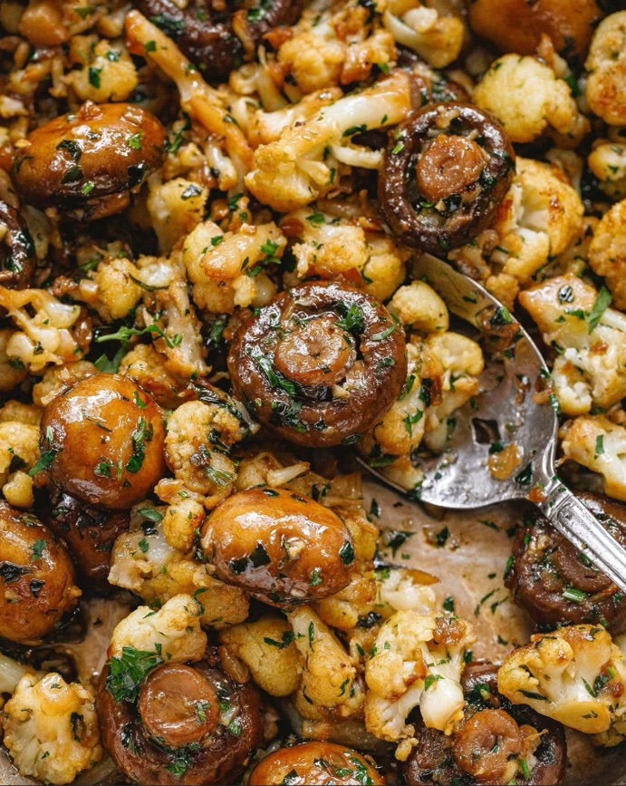

# Garlic Mushrooms Cauliflower Skillet

## Ingredients

- 4 tbsp unsalted butter (or ghee)
- 1 tbsp olive oil
- 1/2 onion, chopped
- 1/2 head cauliflower, cut into florets
- 1 lb whole mushrooms, cleaned
- 2 tbsp vegetable stock
- 1 tsp fresh thyme leaves, chopped
- 2 tbsp fresh parsley, chopped
- 4 cloves garlic, minced
- 1/2 teaspoon salt and pepper, or to taste

## Instructions

1. Heat the butter and oil in a large pan or skillet over medium-high heat.
2. Saute the onion until softened (about 3 minutes).
3. Add the mushrooms and cook for about 4-5 minutes on all sides. Make sure the mushrooms render as much moisture as possible. Brown them a little more, if necessary, to avoid the side dish becoming soggy at the end.
4. Once mushrooms are well browned, add cauliflower florets. Cook until golden and crispy on the edges, about 8-10 minutes. Veggies must be well browned.
5. Pour in the vegetable stock and cook for 2 minutes, to reduce the sauce slightly.
6. Add thyme, one tablespoon of parsley, and garlic. Cook the mushrooms and cauliflower for half a minute, until fragrant. Season generously with salt and pepper to taste, sprinkle with remaining parsley, and serve the garlic butter, mushrooms, and cauliflower skillet immediately.
