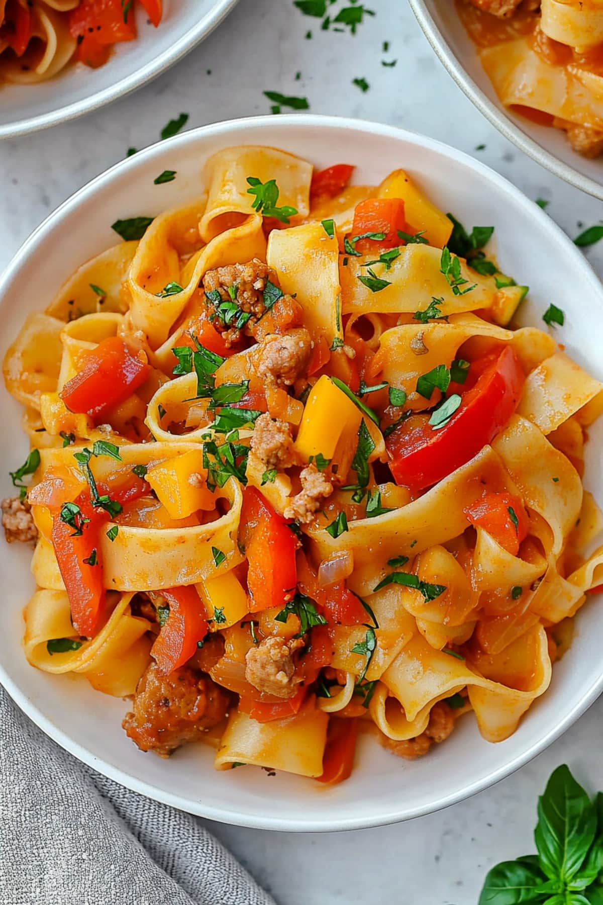

# Italian Drunken Noodles

## Ingredients

- 8 oz fettuccine or wide rice noodles
- 2 tbsp olive oil
- 3 cloves garlic minced
- 1 red bell pepper sliced
- 1 cup cherry tomatoes halved
- 1/2 cup white wine or chicken broth
- 1/4 cup soy sauce
- 2 tbsp balsamic vinegar
- 1/2 tsp red pepper flakes
- 1/4 cup fresh basal chopped
- 1/4 cup grated Parmesan cheese
- Salt and pepper to taste

## Instructions

1. Boil the noodles according to package directions. Drain and set aside.
2. In a large skillet, heat the olive oil over medium heat. Add the minced garlic and cook until fragrant.
3. Add sliced red bell pepper and halved cherry tomatoes to the skillet and sauté until the peppers are tender.
4. Pour in the white wine or chicken broth, soy sauce and balsamic vinegar. Stir to combine and let it simmer for 2-3 minutes.
5. Add the cooked noodles to the skillet and toss to combine.
6. Stir in the red pepper flakes and season with salt and pepper to taste.
7. Remove from the heat. Stir in the fresh basal leaves and grated Parmesan cheese.
8. Serve immediately, garnished with basal leaves and grated Parmesan cheese.

*Photo: Insanely Good Recipes — [Italian Drunken Noodles](https://insanelygoodrecipes.com/italian-drunken-noodles/)*
