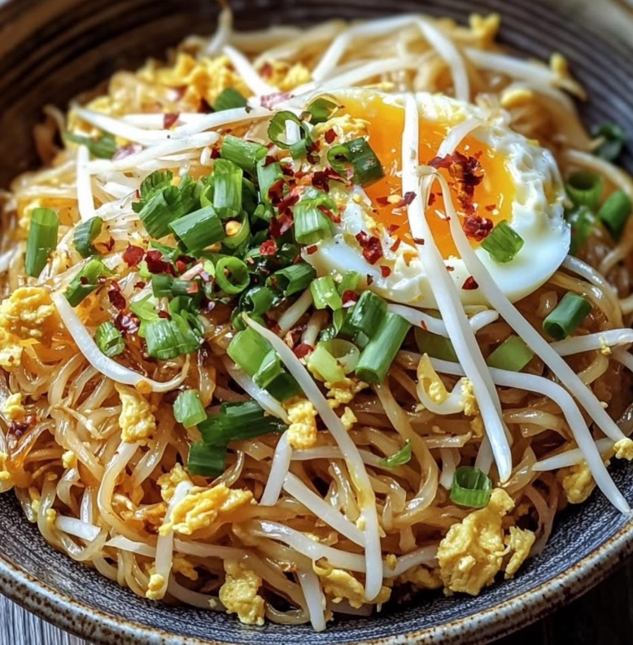

# Pad Thai Noodles

## Ingredients

- 8 oz rice noodles
- 2 tbsp vegetable oil
- 2 garlic cloves, minced
- 2 eggs, beaten
- 1 cup bean sprouts
- 3 green onions, chopped
- 1 tbsp soy sauce
- 2 tbsp fish sauce
- 1 tbsp brown sugar
- 1 tbsp rice vinegar
- 1/4 tsp red pepper flakes (optional)
- 1 lime, cut into wedges
- Optional: Soft-boiled egg for topping

## Instructions

1. Cook noodles: Soak or cook rice noodles according to package instructions. Drain and set aside.
2. Heat vegetable oil in a large pan over medium heat. Add garlic and cook for 1 minute until fragrant.
3. Push garlic to the side of the pan and pour in beaten eggs. Scramble until just set.
4. In a small bowl, whisk together soy sauce, fish sauce, brown sugar, and rice vinegar.
5. Add cooked noodles to the pan along with the sauce. Toss until evenly coated.
6. Stir in bean sprouts, green onions, and red pepper flakes (if using). Cook for 1-2 minutes until heated through.
7. Plate noodles and garnish with a soft-boiled egg, extra green onions, and lime wedges.
