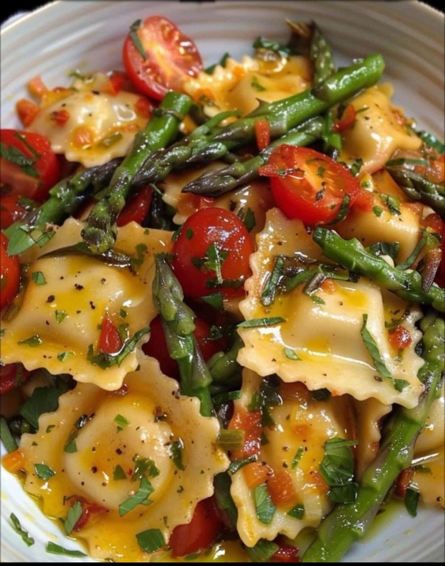

# Ravioli with Tomatoes, Asparagus, Garlic, and Herbs

## Ingredients

- 1 tbsp olive oil
- 1 lb asparagus, ends trimmed, cut into 2-inch pieces
- 2 cups cherry tomatoes, halved
- 3 cloves garlic, minced
- Salt and pepper to taste
- 1/4 cup chicken broth
- 1 tbsp lemon juice
- 1/4 cup fresh basil, chopped
- 1/4 cup fresh parsley, chopped
- 1/4 cup grated Parmesan cheese, plus more for serving
- 1 package (20 ounces) refrigerated cheese ravioli

## Instructions

1. Cook the ravioli according to the package instructions. Drain and set aside.
2. In a large skillet, heat the olive oil over medium-high heat.
3. Add the asparagus and cook for 4-5 minutes until tender-crisp.
4. Add the cherry tomatoes and garlic to the skillet. Season with salt and pepper. Cook for another 2-3 minutes until the tomatoes begin to soften.
5. Pour in the chicken broth and lemon juice. Bring to a simmer and cook for 2 minutes.
6. Add the cooked ravioli to the skillet and gently toss to combine with the vegetables and sauce.
7. Stir in the fresh basil, parsley, and grated Parmesan cheese. Cook for another 1-2 minutes until everything is heated through.
8. Serve the ravioli hot, topped with additional Parmesan cheese if desired.
