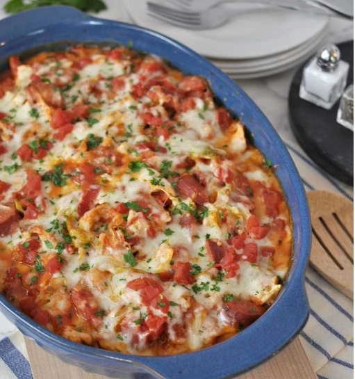
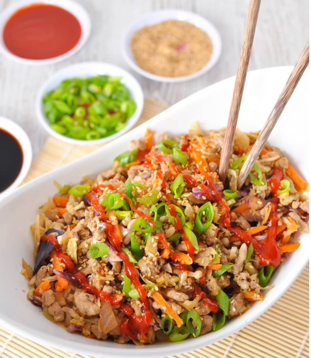
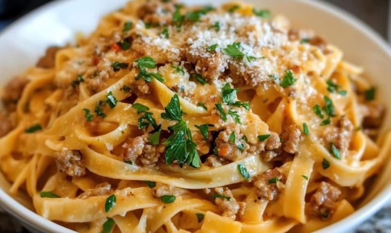
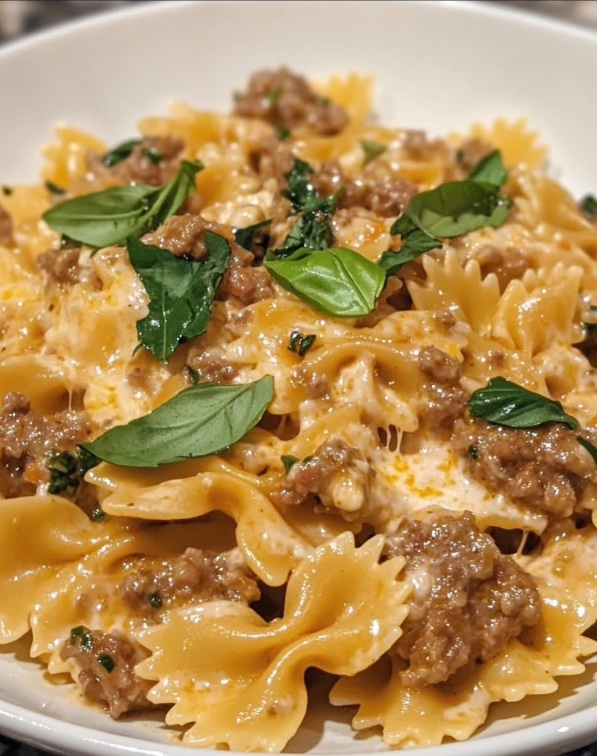
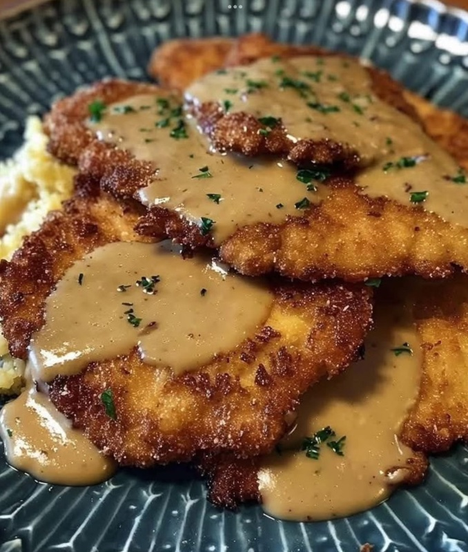

# Pork Recipes

8 recipes.



<div class="recipe-grid">
<div class="recipe-card"><a href="https://chknfrdstk.github.io/Recipes/pork/cheesy-smoked-sausage-and-cabbage-casserole.html"><span class="recipe-title">Cheesy Smoked Sausage and Cabbage Casserole</span></a></div>
<div class="recipe-card"><a href="https://chknfrdstk.github.io/Recipes/pork/egg-roll-in-a-bowl.html"><span class="recipe-title">Egg Roll in a Bowl</span></a></div>
<div class="recipe-card"><a href="https://chknfrdstk.github.io/Recipes/pork/garlic-butter-sausage-fettuccine-pasta.html"><span class="recipe-title">Garlic Butter Sausage Fettuccine Pasta</span></a></div>
<div class="recipe-card"><a href="https://chknfrdstk.github.io/Recipes/pork/honey-garlic-pork-tenderloin.html"><span class="recipe-title">Honey Garlic Pork Tenderloin</span></a></div>
<div class="recipe-card"><a href="https://chknfrdstk.github.io/Recipes/pork/jerk-pork-pineapple-salsa-and-coconut-rice-bowls-with-caribbean-aioli.html"><span class="recipe-title">Jerk Pork, Pineapple Salsa, and Coconut Rice Bowls with Caribbean Aioli</span></a></div>
<div class="recipe-card"><a href="https://chknfrdstk.github.io/Recipes/pork/lemon-basil-sausage-bowtie-pasta-with-garlic-ricotta-sauce.html"><span class="recipe-title">Lemon Basil Sausage Bowtie Pasta with Garlic Ricotta Sauce</span></a></div>
<div class="recipe-card"><a href="https://chknfrdstk.github.io/Recipes/pork/pork-schnitzel-with-dijon-gravy.html"><span class="recipe-title">Pork Schnitzel with Dijon Gravy</span></a></div>
<div class="recipe-card"><a href="https://chknfrdstk.github.io/Recipes/pork/slow-cooker-thai-peanut-pork.html"><span class="recipe-title">Slow Cooker Thai Peanut Pork</span></a></div>
</div>

- [Back to all recipes](https://chknfrdstk.github.io/Recipes/)

## Folder structure

```
pork/
├── README.md
├── cheesy-smoked-sausage-and-cabbage-casserole.md
├── egg-roll-in-a-bowl.md
├── garlic-butter-sausage-fettuccine-pasta.md
├── honey-garlic-pork-tenderloin.md
├── images/
│   ├── cheesy-smoked-sausage-and-cabbage-casserole.jpg
│   ├── egg-roll-in-a-bowl.jpg
│   ├── garlic-butter-sausage-fettuccine-pasta.jpg
│   ├── honey-garlic-pork-tenderloin.jpg
│   ├── jerk-pork-pineapple-salsa-and-coconut-rice-bowls-with-caribbean-aioli.jpg
│   ├── lemon-basil-sausage-bowtie-pasta-with-garlic-ricotta-sauce.jpg
│   ├── pork-schnitzel-with-dijon-gravy.jpg
│   └── slow-cooker-thai-peanut-pork.jpg
├── jerk-pork-pineapple-salsa-and-coconut-rice-bowls-with-caribbean-aioli.md
├── lemon-basil-sausage-bowtie-pasta-with-garlic-ricotta-sauce.md
├── pork-schnitzel-with-dijon-gravy.md
└── slow-cooker-thai-peanut-pork.md
```
