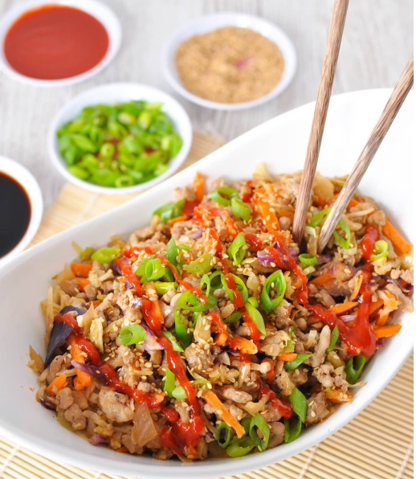

# Egg Roll in a Bowl

## Ingredients

- 2 tbsp toasted sesame oil
- 3 cloves garlic minced
- 1/2 cup onion sliced thin
- 5 green onions sliced on a bias (white and green parts)
- 1 lb ground pork
- 1/2 tsp ground ginger
- 14 ounce bag coleslaw mix
- 3 tbsp soy sauce or coconut aminos
- 1 tbsp rice vinegar
- 2 tbsp toasted sesame seeds
- Yum Yum Sauce for serving

## Instructions

1. Heat the sesame oil in a large skillet over medium high heat.
2. Add the garlic, onion and white portion of the green onions. Sauté until the onions are translucent and the garlic is fragrant.
3. Add the ground pork, ginger, salt, pepper and Sriracha. Sauté until the pork is cooked through.
4. Add the coleslaw mix, soy sauce and rice vinegar. Sauté until the coleslaw is tender.
5. Top with green onions and sesame seeds before serving.
