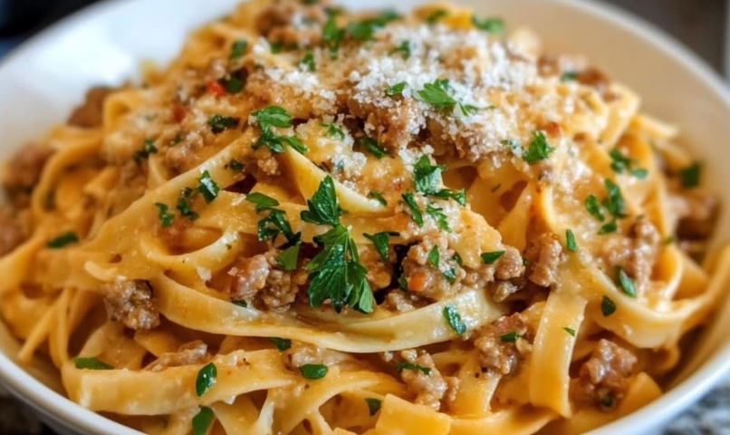

# Garlic Butter Sausage Fettuccine Pasta

## Ingredients

- 12 oz fettuccine pasta
- 2 tbsp olive oil
- 1 lb Italian sausage (either mild or spicy), casings removed and crumbled
- 4 cloves garlic, minced
- 1/2 cup unsalted butter
- 1 cup heavy cream
- 1/2 cup grated Parmesan cheese
- Salt and black pepper, to taste
- 1 tbsp fresh parsley, chopped
- 1/4 tsp red pepper flakes (optional, for heat)
- Extra Parmesan cheese, for serving

## Instructions

1. Bring a large pot of salted water to a boil. Add the fettuccine and cook according to package instructions, until al dente. Drain the pasta, reserving 1/2 cup of pasta water, and set aside.
2. In a large skillet, heat the olive oil over medium heat. Add the crumbled sausage and cook, breaking it up with a spoon, until browned and cooked through. Remove the sausage from the skillet and set aside.
3. In the same skillet, melt the butter over medium heat. Add the minced garlic and cook until fragrant. Stir in the heavy cream and bring to a simmer. Cook for 3-4 minutes, allowing the sauce to thicken slightly.
4. Add the cooked fettuccine to the skillet, tossing to coat in the creamy garlic butter sauce. Stir in the cooked sausage and reserved pasta water, if needed, to thin the sauce to your desired consistency.
5. Sprinkle the pasta with grated Parmesan cheese, fresh parsley, and red pepper flakes (if using). Season with salt and pepper to taste.
6. Serve immediately with additional Parmesan on top.
