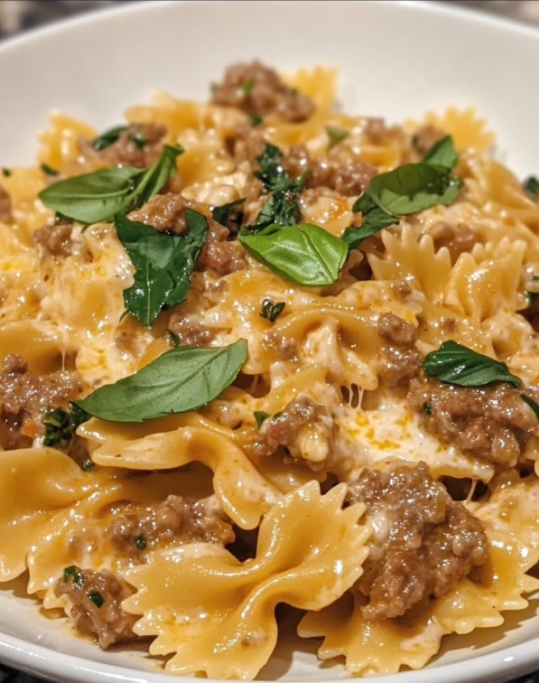

# Lemon Basil Sausage Bowtie Pasta with Garlic Ricotta Sauce

## Ingredients

### For the Pasta and Sausage

- 12 oz bowtie pasta (farfalle)
- 1 lb Italian sausage (mild or spicy), casings removed
- 2 tbsp olive oil
- 2 cloves garlic, minced
- 1 cup fresh basil leaves, chopped
- Zest and juice of 1 lemon
- Salt and pepper, to taste

### For the Garlic Ricotta Sauce

- 1 tbsp butter
- 3 cloves garlic, minced
- 1 cup whole milk ricotta cheese
- 1/2 cup heavy cream
- 1/4 cup grated Parmesan cheese
- 1/2 tsp Italian seasoning
- Salt and pepper, to taste

## Instructions

1. Cook the bowtie pasta in salted boiling water according to package directions until al dente. Reserve 1/2 cup pasta water, then drain and set aside.
2. In a large skillet over medium heat, heat olive oil. Add the Italian sausage, breaking it up with a spoon, and cook until browned and cooked through.
3. Stir in the minced garlic and cook for 1 minute until fragrant.
4. While the sausage cooks, prepare the garlic ricotta sauce. In a saucepan, melt butter over medium heat. Add minced garlic and cook until fragrant (about 30 seconds). Stir in ricotta cheese, heavy cream, Parmesan cheese, and Italian seasoning. Cook for 3-4 minutes, stirring, until the sauce is smooth and creamy.
5. Season with salt and pepper to taste.
6. Toss the cooked pasta into the sausage skillet. Add the garlic ricotta sauce, lemon zest, and lemon juice. Stir until everything is combined and coated, adding reserved pasta water a little at a time if needed to loosen the sauce.
7. Fold in the fresh basil and cook for 1 more minute. Season with salt and pepper to taste.
8. Serve warm, garnished with extra basil and Parmesan if desired.
