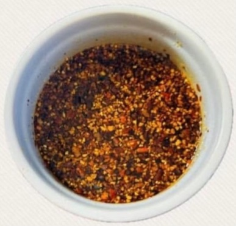
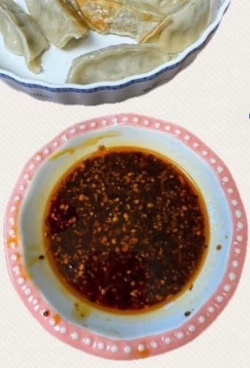
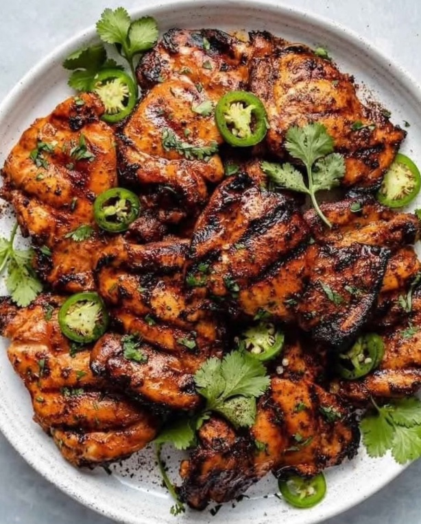

# Sauce Recipes

11 recipes.

<a href="https://chknfrdstk.github.io/Recipes/sauce/chili-garlic-oil.html">Chili Garlic Oil</a>

<a href="https://chknfrdstk.github.io/Recipes/sauce/chunky-dumpling-sauce.html">Chunky Dumpling Sauce</a>

<a href="https://chknfrdstk.github.io/Recipes/sauce/cilantro-lime-avacodo-salsa.html">Cilantro Lime Avacodo Salsa</a>

<a href="https://chknfrdstk.github.io/Recipes/sauce/dumpling-sauce.html">Dumpling Sauce</a>

<a href="https://chknfrdstk.github.io/Recipes/sauce/hot-honey-ranch.html">Hot Honey Ranch</a>

<a href="https://chknfrdstk.github.io/Recipes/sauce/korean-sauce.html">Korean Sauce</a>

<a href="https://chknfrdstk.github.io/Recipes/sauce/lemon-herb-aioli.html">Lemon-Herb Aioli</a>

<a href="https://chknfrdstk.github.io/Recipes/sauce/ranch.html">Ranch</a>

<a href="https://chknfrdstk.github.io/Recipes/sauce/vietnamese-fish-sauce-recipe-nuoc-cham.html">Vietnamese Fish Sauce Recipe (Nước Chấm)</a>

<a href="https://chknfrdstk.github.io/Recipes/sauce/wing-stop-ranch.html">Wing Stop Ranch</a>

<a href="https://chknfrdstk.github.io/Recipes/sauce/zesty-chili-lime-marinade.html">Zesty Chili Lime Marinade</a>

- [Back to all recipes](https://chknfrdstk.github.io/Recipes/)
