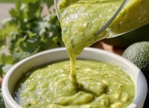

# Sauce Recipes

11 recipes.

<a href="chili-garlic-oil.md">Chili Garlic Oil</a>

<a href="chunky-dumpling-sauce.md">Chunky Dumpling Sauce</a>

<a href="cilantro-lime-avacodo-salsa.md">Cilantro Lime Avacodo Salsa</a>

<a href="dumpling-sauce.md">Dumpling Sauce</a>

<a href="hot-honey-ranch.md">Hot Honey Ranch</a>

<a href="korean-sauce.md">Korean Sauce</a>

<a href="lemon-herb-aioli.md">Lemon-Herb Aioli</a>

<a href="ranch.md">Ranch</a>

<a href="vietnamese-fish-sauce-recipe-nuoc-cham.md">Vietnamese Fish Sauce Recipe (Nước Chấm)</a>

<a href="wing-stop-ranch.md">Wing Stop Ranch</a>

<a href="zesty-chili-lime-marinade.md">Zesty Chili Lime Marinade</a>

- [Back to all recipes](../README.md)
