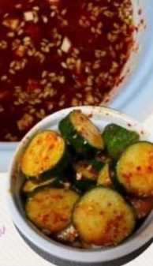
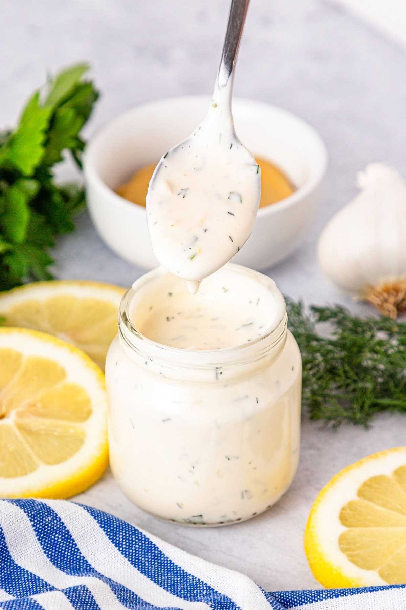
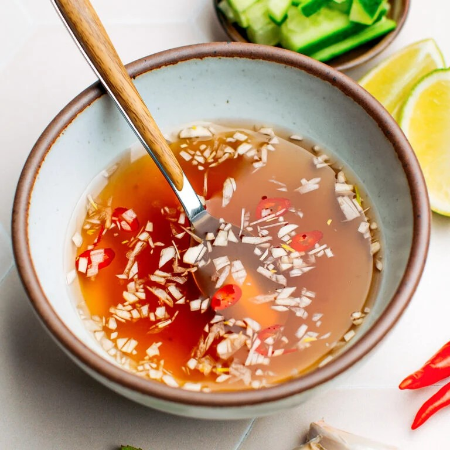

# Sauce Recipes

11 recipes.



<div class="recipe-grid">
<div class="recipe-card"><a href="https://chknfrdstk.github.io/Recipes/sauce/chili-garlic-oil.html"><span class="recipe-title">Chili Garlic Oil</span></a></div>
<div class="recipe-card"><a href="https://chknfrdstk.github.io/Recipes/sauce/chunky-dumpling-sauce.html"><span class="recipe-title">Chunky Dumpling Sauce</span></a></div>
<div class="recipe-card"><a href="https://chknfrdstk.github.io/Recipes/sauce/cilantro-lime-avocado-salsa.html"><span class="recipe-title">Cilantro Lime Avocado Salsa</span></a></div>
<div class="recipe-card"><a href="https://chknfrdstk.github.io/Recipes/sauce/dumpling-sauce.html"><span class="recipe-title">Dumpling Sauce</span></a></div>
<div class="recipe-card"><a href="https://chknfrdstk.github.io/Recipes/sauce/hot-honey-ranch.html"><span class="recipe-title">Hot Honey Ranch</span></a></div>
<div class="recipe-card"><a href="https://chknfrdstk.github.io/Recipes/sauce/korean-sauce.html"><span class="recipe-title">Korean Sauce</span></a></div>
<div class="recipe-card"><a href="https://chknfrdstk.github.io/Recipes/sauce/lemon-herb-aioli.html"><span class="recipe-title">Lemon-Herb Aioli</span></a></div>
<div class="recipe-card"><a href="https://chknfrdstk.github.io/Recipes/sauce/ranch.html"><span class="recipe-title">Ranch</span></a></div>
<div class="recipe-card"><a href="https://chknfrdstk.github.io/Recipes/sauce/vietnamese-fish-sauce-recipe-nuoc-cham.html"><span class="recipe-title">Vietnamese Fish Sauce Recipe (Nước Chấm)</span></a></div>
<div class="recipe-card"><a href="https://chknfrdstk.github.io/Recipes/sauce/wing-stop-ranch.html"><span class="recipe-title">Wing Stop Ranch</span></a></div>
<div class="recipe-card"><a href="https://chknfrdstk.github.io/Recipes/sauce/zesty-chili-lime-marinade.html"><span class="recipe-title">Zesty Chili Lime Marinade</span></a></div>
</div>

- [Back to all recipes](https://chknfrdstk.github.io/Recipes/)

## Folder structure

```
sauce/
├── README.md
├── chili-garlic-oil.md
├── chunky-dumpling-sauce.md
├── cilantro-lime-avocado-salsa.md
├── dumpling-sauce.md
├── hot-honey-ranch.md
├── images/
│   ├── chili-garlic-oil.jpg
│   ├── chunky-dumpling-sauce.jpg
│   ├── cilantro-lime-avocado-salsa.jpg
│   ├── dumpling-sauce.jpg
│   ├── hot-honey-ranch.jpg
│   ├── korean-sauce.jpg
│   ├── lemon-herb-aioli.jpg
│   ├── ranch.jpg
│   ├── vietnamese-fish-sauce-recipe-nuoc-cham.jpg
│   ├── wing-stop-ranch.jpg
│   └── zesty-chili-lime-marinade.jpg
├── korean-sauce.md
├── lemon-herb-aioli.md
├── ranch.md
├── vietnamese-fish-sauce-recipe-nuoc-cham.md
├── wing-stop-ranch.md
└── zesty-chili-lime-marinade.md
```
