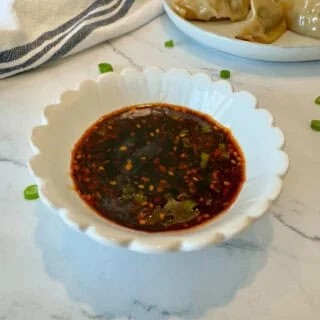

# Chunky Dumpling Sauce

## Ingredients

- 1 tbsp minced garlic
- 1/2 tbsp minced ginger
- 1.5 tbsp toasted sesame seeds
- 2 tbsp sugar
- 5 tbsp low sodium soy sauce
- 4 tbsp rice vinegar
- 3 tbsp roasted unsalted chopped peanuts
- 1 tbsp sesame oil
- 1/4 cup chili oil
- 1/4 cup sliced green scallions
- 1/4 cup chopped cilantro

*Photo: The Savory Chopstick — [The Best Dumpling Dipping Sauce | Easy Recipe](https://www.thesavorychopstick.com/dumpling-sauce/)*
