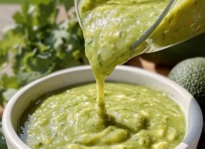

# Cilantro Lime Avocado Salsa

## Ingredients

- 6 tomatillos
- 1 jalapeño
- 2 avocados
- 1/2 cup cilantro
- 1/2 cup Mexican crema
- 1 tbsp minced garlic
- 1 tbsp salt
- 2 limes, juiced
- 1 tbsp chicken bouillon
- 1 tbsp salt
- 1/4 of an onion

## Instructions

1. Start by boiling 6 tomatillos and 1 jalapeño (optional for added spice) for about 10 minutes.
2. In a blender, combine 2 avocados, cilantro, crema, minced garlic, chicken bouillon, salt, lime juice and onion.
3. Once the tomatillos and jalapeño are boiled, add them to the blender along with about a cup of the boiling water.
4. Blend everything until it's smooth and creamy, then adjust the salt to taste.
