# Seafood Recipes

14 recipes.



<a href="https://chknfrdstk.github.io/Recipes/seafood/coconut-lime-fish-curry-with-jasmine-rice.html">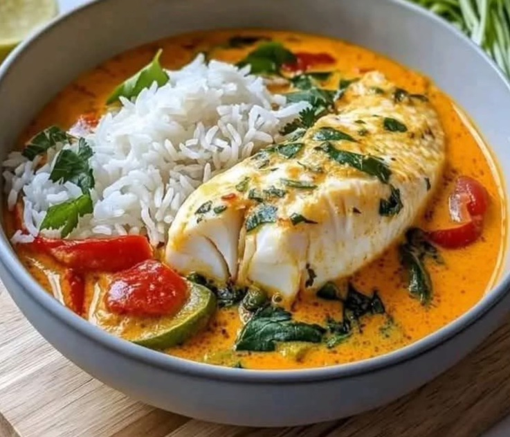Coconut Lime Fish Curry with Jasmine Rice</a>

<a href="https://chknfrdstk.github.io/Recipes/seafood/coconut-lime-fish-with-avocado-salsa.html">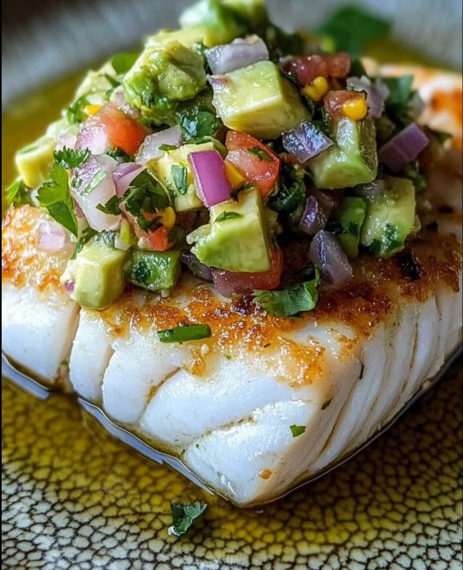Coconut Lime Fish with Avocado Salsa</a>

<a href="https://chknfrdstk.github.io/Recipes/seafood/crawfish-etouffee.html">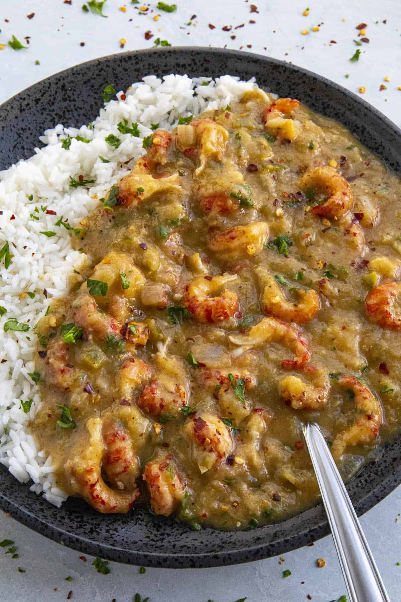Crawfish Étouffée</a>

<a href="https://chknfrdstk.github.io/Recipes/seafood/creamy-tuscan-spaghetti-with-jumbo-scallops.html">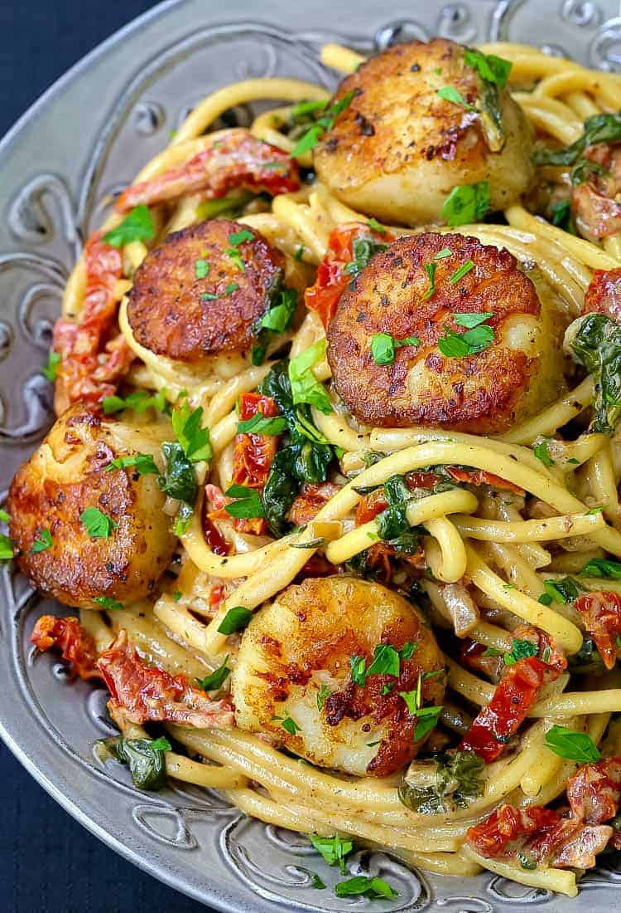Creamy Tuscan Spaghetti with Jumbo Scallops</a>

<a href="https://chknfrdstk.github.io/Recipes/seafood/easy-ginger-soy-cod.html">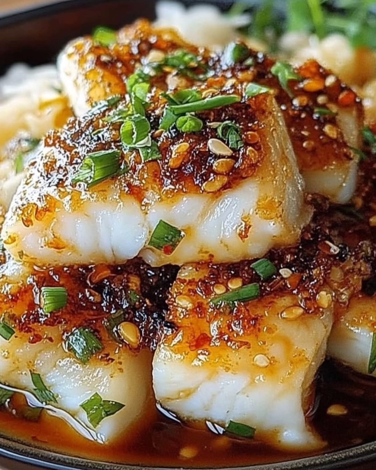Easy Ginger Soy Cod</a>

<a href="https://chknfrdstk.github.io/Recipes/seafood/fiery-shrimp-fajita-bowl-with-cilantro-lime-crema.html">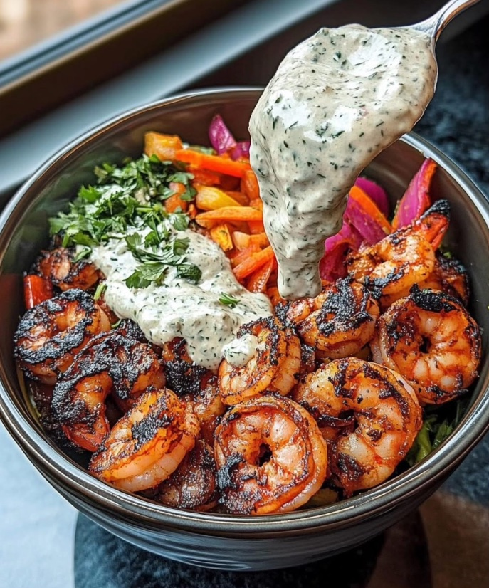Fiery Shrimp Fajita Bowl with Cilantro Lime Crema</a>

<a href="https://chknfrdstk.github.io/Recipes/seafood/hawaiian-shrimp-bowl-with-sriracha-mayo.html">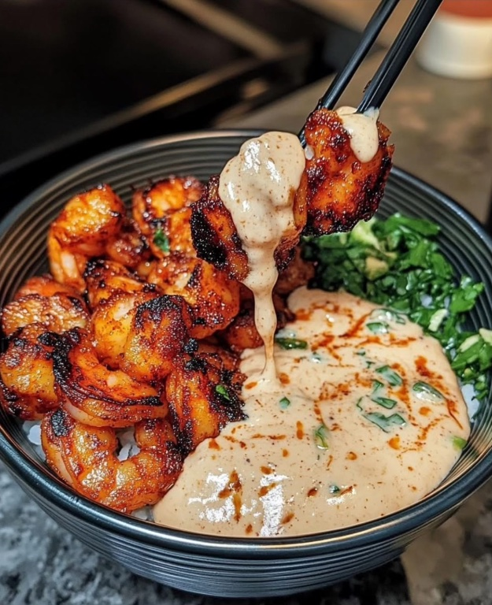Hawaiian Shrimp Bowl with Sriracha Mayo</a>

<a href="https://chknfrdstk.github.io/Recipes/seafood/honey-garlic-shrimp-sausage-and-broccoli.html">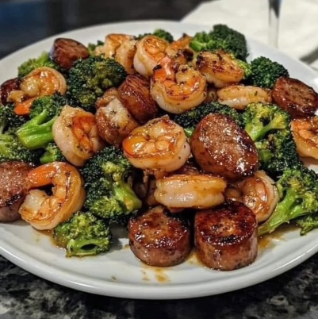Honey Garlic Shrimp, Sausage & Broccoli</a>

<a href="https://chknfrdstk.github.io/Recipes/seafood/louisiana-shrimp-and-sausage-pasta-bake.html">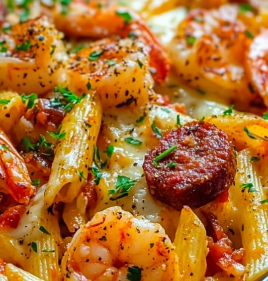Louisiana Shrimp and Sausage Pasta Bake</a>

<a href="https://chknfrdstk.github.io/Recipes/seafood/shrimp-dirty-rice.html">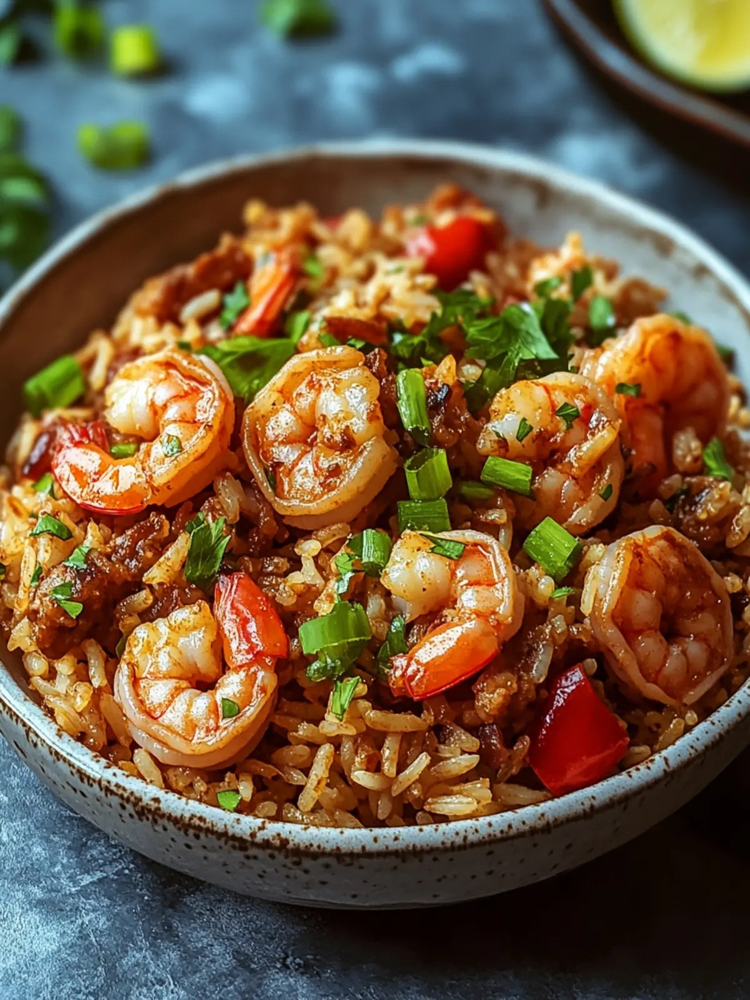Shrimp Dirty Rice</a>

<a href="https://chknfrdstk.github.io/Recipes/seafood/spicy-garlic-parmesan-grilled-shrimp-with-lemon-herb-aioli.html">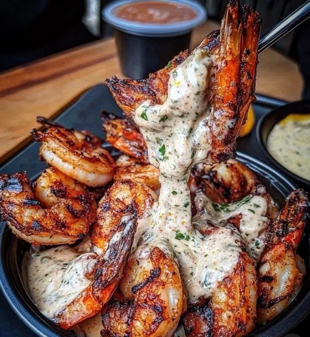Spicy Garlic Parmesan Grilled Shrimp with Lemon-Herb Aioli</a>

<a href="https://chknfrdstk.github.io/Recipes/seafood/spicy-shrimp-tacos-with-garlic-cilantro-lime-slaw.html">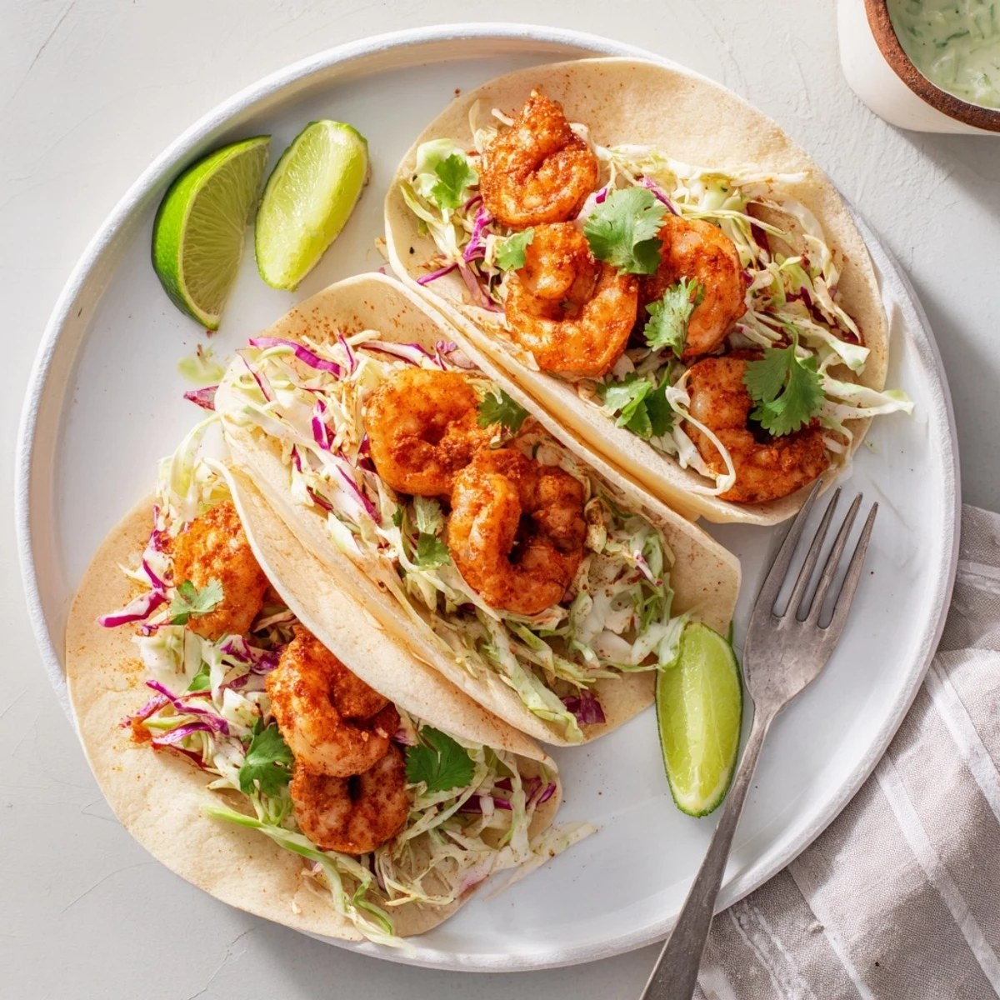Spicy Shrimp Tacos with Garlic Cilantro Lime Slaw</a>

<a href="https://chknfrdstk.github.io/Recipes/seafood/teriyaki-salmon-bowls-with-crispy-brussels-sprouts.html">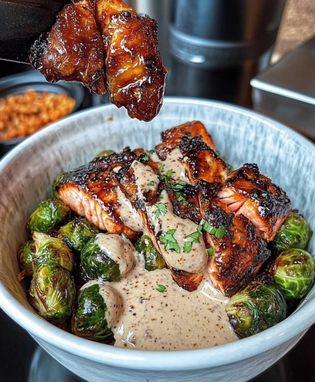Teriyaki Salmon Bowls with Crispy Brussels Sprouts</a>

<a href="https://chknfrdstk.github.io/Recipes/seafood/thai-peanut-shrimp-rice-bowl.html">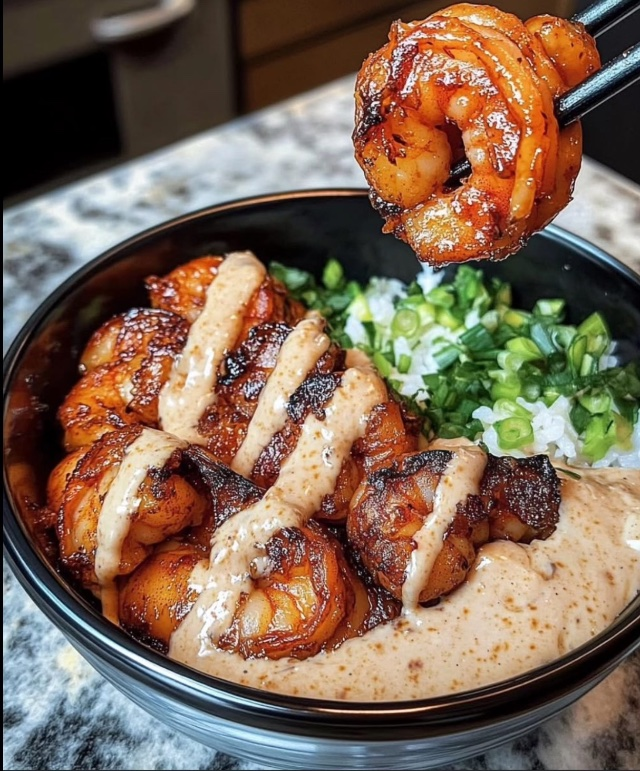Thai Peanut Shrimp Rice Bowl</a>

- [Back to all recipes](https://chknfrdstk.github.io/Recipes/)
