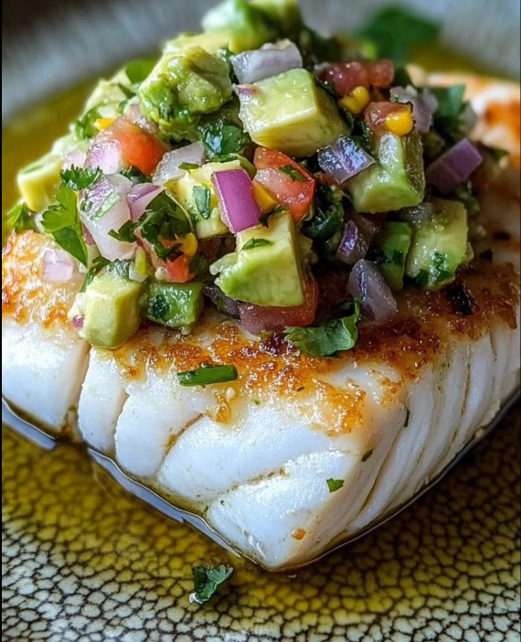

# Coconut Lime Fish with Avocado Salsa

## Ingredients

### For the Coconut Lime Fish

- 4 fillets of white fish (such as cod, tilapia, or snapper)
- Salt and freshly ground black pepper, to taste
- Zest of 1 lime
- Juice of 2 limes
- ½ cup of creamy coconut milk
- 2 tbsp of olive oil
- 2 garlic cloves, finely minced
- ¼ teaspoon of red pepper flakes (optional, for a hint of spice)
- Fresh cilantro, chopped, for garnish

### For the Avocado Salsa

- 1 large avocado, diced
- ½ cup of cherry tomatoes, quartered
- ¼ cup of red onion, finely diced
- Juice of 1 lime
- Salt and freshly ground black pepper, to taste
- A handful of fresh cilantro, chopped

## Instructions

1. In a shallow dish, mix together the lime zest, lime juice, coconut milk, olive oil, garlic, red pepper flakes, salt, and pepper.
2. Add the fish fillets to the dish, ensuring they're evenly coated.
3. Cover and refrigerate for at least 15-20 minutes to infuse the flavors.
4. In a bowl, combine the diced avocado, cherry tomatoes, red onion, lime juice, salt, pepper, and cilantro.
5. Gently toss until everything is evenly mixed. Set the salsa aside to let the flavors meld.
6. Heat a large skillet over medium heat. Remove the fish fillets from the marinade, letting any excess drip off.
7. Place the fillets in the skillet and cook for 3-4 minutes on each side, or until the fish is opaque and easily flakes with a fork.
8. Transfer the fish to serving plates and top each fillet with a generous spoonful of avocado salsa.
9. Garnish with fresh cilantro and lime wedges for extra zest, if desired.
