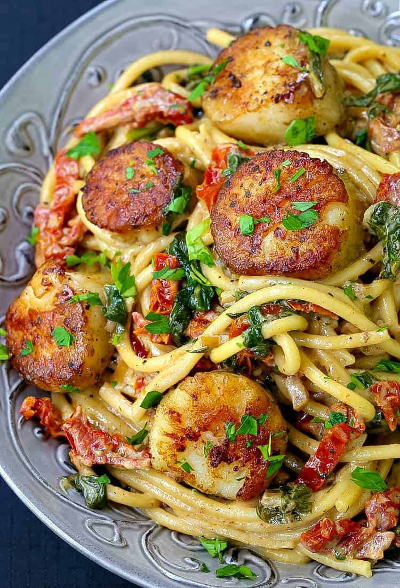

# Creamy Tuscan Spaghetti with Jumbo Scallops

## Ingredients

- 8 oz spaghetti (or pasta of your choice)
- 1 lb jumbo scallops
- 2 tbsp olive oil
- 3 cloves garlic minced
- 1 cup cherry tomatoes halved
- 1 cup fresh spinach
- 1 cup heavy cream
- 1/2 cup grated Parmesan cheese
- Salt and pepper to taste
- Fresh basil for garnish

## Instructions

1. Cook the according to the package directions. Drain and set aside, reserving a little of the pasta water.
2. Pat the scallops dry and season both sides with salt and pepper.
3. In a large skillet, heat the olive oil over medium-high heat. Once hot, add the scallops and sear them for about 2-3 minutes on each side until they are cooked golden brown and cooked through. Remove the scallops from the pan and set aside.
4. In the same pan, add the garlic and sauté until fragrant. Add the cherry tomatoes and cook for about 2-3 minutes until they start to soften. then add the spinach and cook until wilted.
5. Pour in the heavy cream and bring it to a gentle simmer. Stir in the grated Parmesan cheese until melted and combined. If the sauce is too thick, you can use the reserved pasta water to reach your desired consistency.
6. Add the cooked pasta to the skillet and toss until evenly coated with the sauce.
7. Plate the coated pasta and top with the seared scallops. Garnish with fresh basil if desired.

*Photo: Mantitlement — [Creamy Tuscan Spaghetti with Jumbo Scallops](https://www.mantitlement.com/creamy-tuscan-spaghetti-with-jumbo-scallops/comment-page-2/)*
