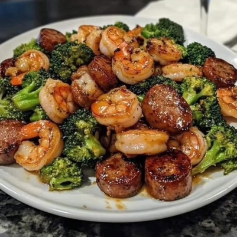

# Honey Garlic Shrimp, Sausage & Broccoli

## Ingredients

- 1 lb large shrimp peeled and deveined
- 8 oz smoked sausage sliced into 1/2-inch pieces
- 2 cups broccoli florets
- 4 cloves garlic minced
- 1/4 cup honey
- 1/4 cup soy sauce
- 1 tbsp olive oil
- 1 tbsp lemon juice
- 1/4 tsp red pepper flakes (optional, for heat)
- Salt and pepper to taste
- Cooked rice for serving
- Fresh parsley or cilantro, chopped for garnish

## Instructions

1. In a small bowl, whisk together the honey, soy sauce, minced garlic, lemon juice, and red pepper flakes (if using) and set aside.
2. In a large skillet, heat the olive oil over medium-high heat. Add the sliced sausage and cook for 4-5 minutes, stirring occasionally, until browned on both sides. Remove the sausage from the skillet and set aside.
3. In the same skillet, add the shrimp. Season with salt and pepper. Cook for 2-3 minutes on each side, until the shrimp turn pink and opaque. Remove the shrimp from the skillet and set aside with the sausage.
4. Add the broccoli florets to the skillet, and sauté for about 4-5 minutes until they are tender-crisp. You can add a splash of water to the skillet to help steam the broccoli if needed.
5. Return the sausage and shrimp to the skillet with the broccoli. Pour the honey garlic sauce over the mixture and stir to coat everything evenly. Cook for an additional 2-3 minutes, allowing the sauce to thicken slightly and coat the ingredients.
6. Serve the honey garlic shrimp, sausage, and broccoli over cooked rice. Garnish with fresh parsley or cilantro.
