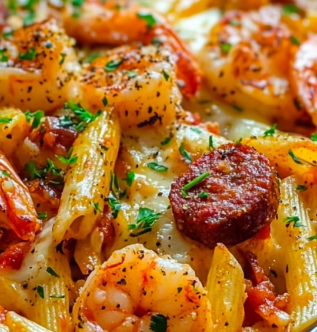

# Louisiana Shrimp and Sausage Pasta Bake

## Ingredients

- 12 oz penne pasta
- 1 lb shrimp, peeled and deveined
- 8 oz andouille sausage, sliced
- 2 tbsp olive oil
- 1 red bell pepper, diced
- 1 green bell pepper, diced
- 3 cloves garlic, minced
- 2 cups heavy cream
- 1 cup grated Parmesan cheese
- 1 cup shredded mozzarella cheese
- 2 tsp Cajun seasoning
- 1/2 tsp paprika
- Salt and pepper to taste
- Chopped parsley (for garnish)

## Instructions

1. Cook penne pasta according to package instructions. Drain and set aside.
2. Heat olive oil in a large skillet over medium heat. Sauté sausage until browned. Remove and set aside.
3. Add shrimp to the skillet, season with Cajun seasoning, and cook until pink. Remove and set aside.
4. In the same skillet, sauté bell peppers and garlic until softened.
5. Stir in heavy cream, Parmesan cheese, paprika, and additional Cajun seasoning. Simmer for 5 minutes until slightly thickened.
6. Mix cooked pasta, sausage, shrimp, and sauce together. Pour into a greased baking dish.
7. Sprinkle mozzarella cheese on top. Bake at 375°F for 15-20 minutes, or until bubbly and golden.
8. Garnish with chopped parsley and serve warm.
