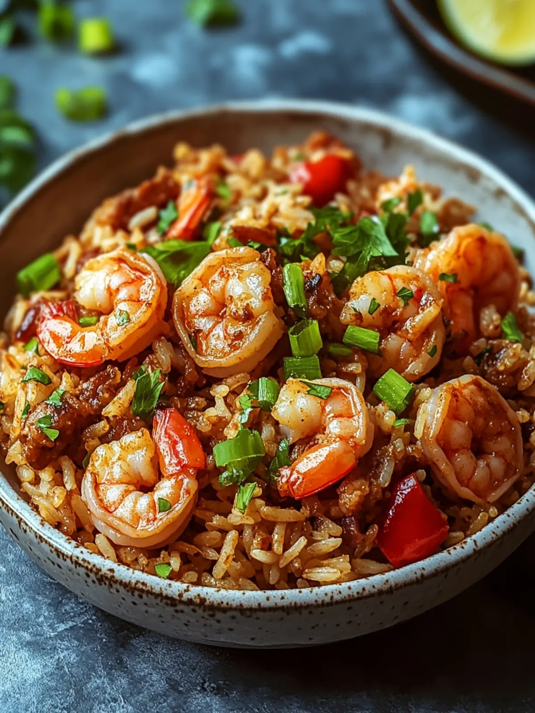

# Shrimp Dirty Rice

## Ingredients

- 1 lb hamburger meat
- 1 lb ground pork sausage
- 10 - 12 shrimp peeled and deveined
- 4 cups cooked rice
- 2 cups chicken broth
- 1 1/2 cup chopped onions and bell peppers
- 3 tbsp vegetable oil
- 1 tsp seafood seasoning
- 1/4 cup flour
- 1 tsp oregano
- 3 tsp minced garlic
- 1 tsp thyme
- 1 tbsp garlic powder
- 1 tsp onion powder
- 1 tsp chili powder
- Pinch of cayenne pepper
- Salt and pepper to taste

## Instructions

1. Season shrimp with seafood seasoning
2. Over medium-high heat add 2 tbsp oil and cook shrimp 2 - 3 minutes on each side until they are pink and cooked through. Remove from the pan and pond set aside
3. In a large skillet, add 1 tbsp oil and then the ground meats. When the meats begin to brown add in the onions, peppers and garlic. When the meats begin to is fully browned add in the remaining seasonings.
4. Next add the flour, stirring well.
5. Add the broth and simmer for 5 - 7 minutes
6. Add cooked rice and simmer an additional 5 minutes or so
7. Add shrimp and store to combine.
8. Enjoy

*Photo: Recipes by Caroline — [Shrimp Dirty Rice](https://www.recipesbycaroline.com/shrimp-dirty-rice/)*
