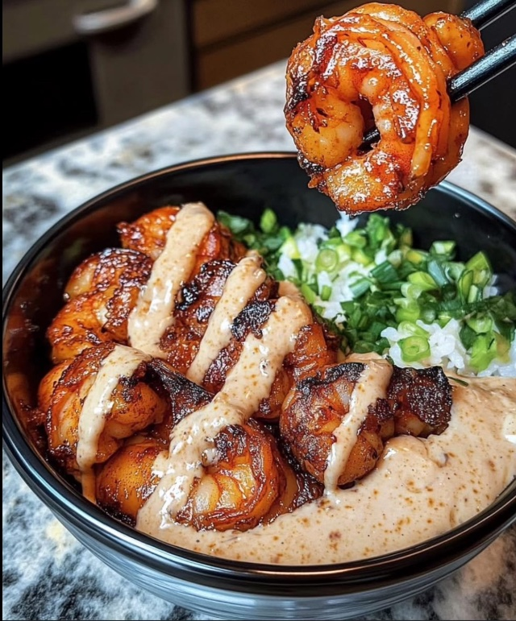

# Thai Peanut Shrimp Rice Bowl

## Ingredients

### For the Shrimp

- 1 lb large shrimp, peeled and deveined
- 2 tbsp soy sauce
- 1 tbsp honey
- 1 tbsp rice vinegar
- 1 tsp minced garlic
- 1/2 tsp grated ginger
- 1/4 tsp red pepper flakes

### For the Rice

- 1 cup jasmine rice
- 1 3/4 cups chicken broth
- 1/4 tsp salt

### For the Peanut Sauce

- 1/4 cup creamy peanut butter
- 2 tbsp soy sauce
- 1 tbsp rice vinegar
- 1 tbsp honey
- 1 tsp minced garlic
- 1/2 tsp grated ginger
- 1/4 tsp sriracha (optional)
- 1 tbsp water

### For the Garnish

- 1/4 cup chopped peanuts
- 1/4 cup chopped cilantro
- Lime wedges (optional)

## Instructions

1. Bring chicken broth and salt to a boil in a saucepan.
2. Add rice, reduce heat, cover, and simmer for 15-20 minutes or until tender.
3. In a bowl, combine shrimp with soy sauce, honey, rice vinegar, garlic, ginger, and red pepper flakes. Marinate for at least 30 minutes.
4. Grill, pan-fry, or bake shrimp until cooked through, about 2-3 minutes per side.
5. In a small bowl, whisk together peanut butter, soy sauce, rice vinegar, honey, garlic, ginger, sriracha (if using), and water until smooth.
6. Divide cooked rice between two bowls.
7. Top with grilled shrimp, peanut sauce, chopped peanuts, and cilantro. Serve with lime wedges, if desired.

## Tips

- You can use any type of rice you prefer.
- For a spicier sauce, add more sriracha or a pinch of red pepper flakes.
- Garnish with other toppings like chopped green onions, sesame seeds, or a fried egg.
