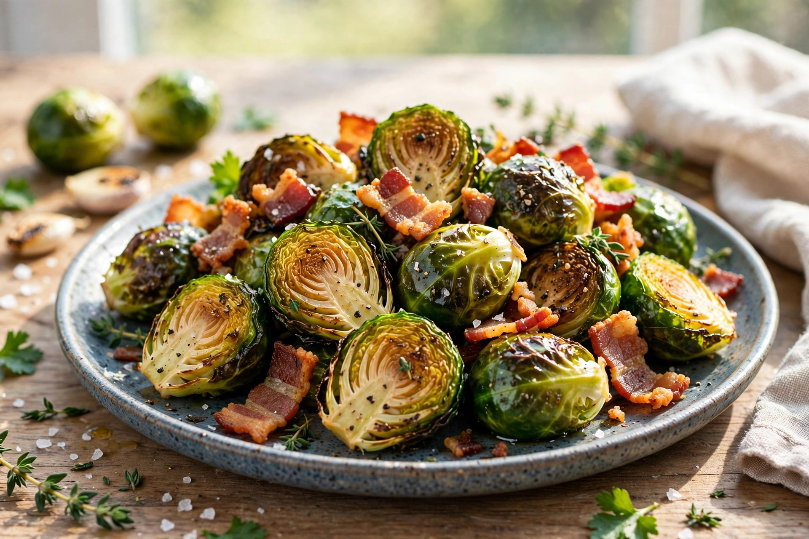

# Bacon Hot Honey Brussels Sprouts

## Ingredients

- 1.5 lbs Brussels sprouts
- 7 slices bacon (or a whole package)
- 1 tsp garlic salt
- 1 tsp onion butter seasoning or onion powder
- 1 tsp paprika
- 1/4 cup olive oil
- 1/2 tsp salt
- 1/2 tsp black pepper
- Honey or hot honey, for drizzling
- Balsamic glaze, for drizzling

## Instructions

1. Put an empty baking sheet in the oven and preheat to 425°F — the hot pan helps everything get extra crispy.
2. Trim and halve the Brussels sprouts. Save any loose leaves; they turn into the best crunchy bits.
3. Toss the sprouts with the olive oil, garlic salt, paprika, and onion seasoning until nicely coated.
4. Pull the hot baking sheet out, drizzle a little more oil on it, and spread the sprouts on it cut-side down. Roast for 20 minutes at 425°F, or until as crispy as you like.
5. While they roast, cut the bacon into small pieces and cook in a pan until crispy.
6. Transfer the sprouts to a large bowl, season with the salt and pepper, and drizzle with honey and plenty of balsamic glaze. Add the bacon and toss everything together.
7. Serve warm and enjoy!

*Source: [Sarah Kraffty on Instagram](https://www.instagram.com/reel/Df3D-XBBWP1/)*
*Photo: recipedelish.com — [Bacon Brussels Sprouts](https://www.recipedelish.com/bacon-brussels-sprouts)*
