# Soups Recipes

43 recipes.

<a href="bacon-cabbage-and-potato-soup.md">Bacon Cabbage and Potato Soup</a>

<a href="bacon-cheeseburger-soup.md">Bacon Cheeseburger Soup</a>

<a href="cabbage-sausage-and-potato-soup.md">Cabbage, Sausage and Potato Soup</a>

<a href="caldo-de-pollo.md">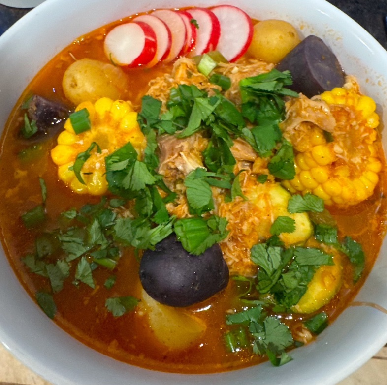Caldo de Pollo</a>

<a href="chicken-avocado-lime-soup.md">Chicken Avocado Lime Soup</a>

<a href="chicken-avocado-soup.md">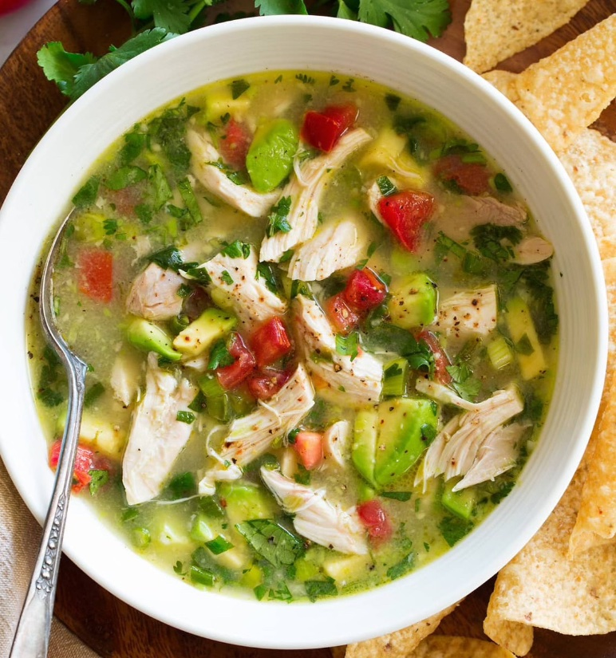Chicken Avocado Soup</a>

<a href="chicken-fajita-soup.md">Chicken Fajita Soup</a>

<a href="chicken-noodle-soup.md">Chicken Noodle Soup</a>

<a href="chinese-style-hot-and-sour-soup.md">Chinese Style Hot and Sour soup</a>

<a href="coconut-lime-seafood-chowder.md">Coconut Lime Seafood Chowder</a>

<a href="coconut-lime-shrimp-soup.md">Coconut Lime Shrimp Soup</a>

<a href="creamy-beef-taco-soup.md">Creamy Beef Taco Soup</a>

<a href="creamy-chicken-enchilada-soup.md">Creamy Chicken Enchilada Soup</a>

<a href="creamy-chicken-poblano-pepper-soup.md">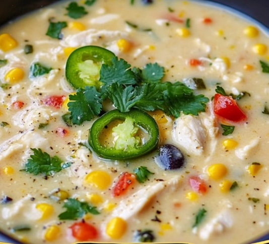Creamy Chicken Poblano Pepper Soup</a>

<a href="creamy-crab-and-shrimp-seafood-bisque.md">Creamy Crab and Shrimp Seafood Bisque</a>

<a href="creamy-crockpot-chicken-chili.md">Creamy Crockpot Chicken Chili</a>

<a href="creamy-mushroom-chicken-and-wild-rice-soup.md">Creamy Mushroom Chicken and Wild Rice Soup</a>

<a href="creamy-parmesan-italian-sausage-ditalini-soup.md">Creamy Parmesan Italian Sausage Ditalini Soup</a>

<a href="creamy-parmesan-italian-sausage-soup.md">Creamy Parmesan Italian Sausage Soup</a>

<a href="creamy-parmesan-mushroom-and-spinach-tortellini-soup.md">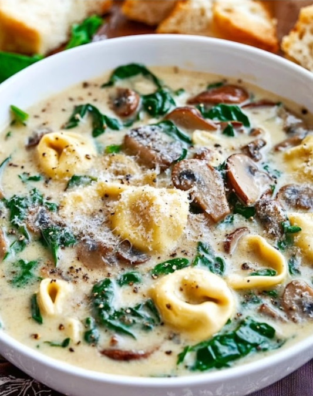Creamy Parmesan Mushroom and Spinach Tortellini Soup</a>

<a href="creamy-spicy-jalapeno-shrimp-soup.md">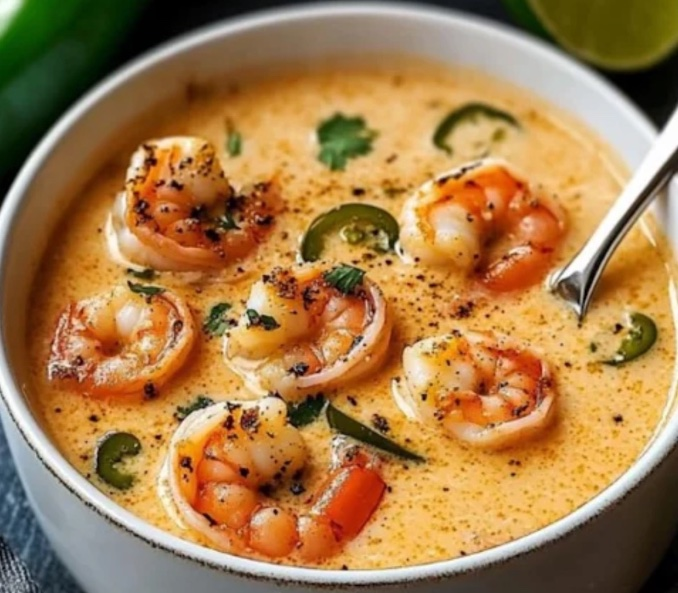Creamy Spicy Jalapeño Shrimp Soup</a>

<a href="creamy-spicy-jalapeno-shrimp-soup-2.md">Creamy Spicy Jalapeño Shrimp Soup</a>

<a href="crock-pot-creamy-chicken-parmesan-soup.md">Crock Pot Creamy Chicken Parmesan Soup</a>

<a href="crock-pot-green-enchilada-chicken-soup.md">Crock Pot Green Enchilada Chicken Soup</a>

<a href="hungarian-mushroom-soup.md">Hungarian Mushroom Soup</a>

<a href="keto-unstuffed-cabbage-soup.md">Keto Unstuffed Cabbage Soup</a>

<a href="lemon-chicken-orzo-soup.md">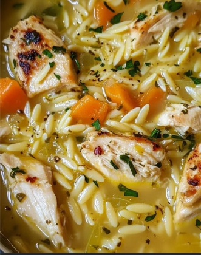Lemon Chicken Orzo Soup</a>

<a href="mexican-corn-chicken-soup.md">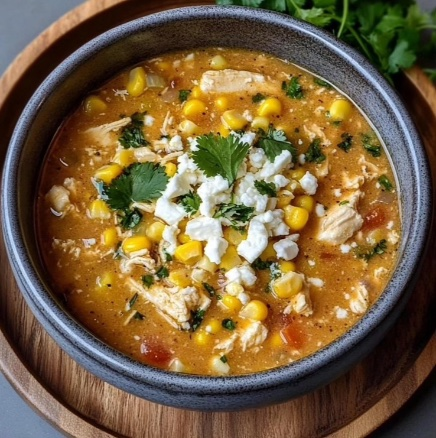Mexican Corn Chicken Soup</a>

<a href="mexican-sopa-de-fideo-with-potatoes-beans-and-ground-beef.md">Mexican Sopa de Fideo with Potatoes, Beans, and Ground Beef</a>

<a href="mexican-street-corn-chicken-soup.md">Mexican Street Corn Chicken Soup</a>

<a href="one-pot-macaroni-cheeseburger-soup.md">One Pot Macaroni Cheeseburger Soup</a>

<a href="potsticker-soup-with-mushrooms-bok-choy.md">Potsticker Soup with Mushrooms & Bok Choy</a>

<a href="ranch-taco-soup.md">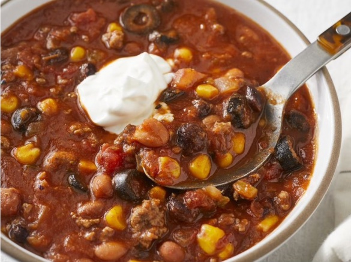Ranch Taco Soup</a>

<a href="rotisserie-chicken-mushroom-soup.md">Rotisserie Chicken Mushroom Soup</a>

<a href="sausage-tortellini-soup.md">Sausage Tortellini Soup</a>

<a href="spicy-jalapeno-popper-chicken-soup.md">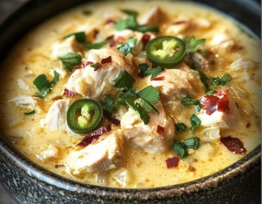Spicy Jalapeño Popper Chicken Soup</a>

<a href="spicy-lemon-fish-soup.md">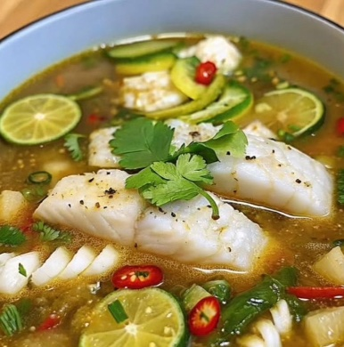Spicy Lemon Fish Soup</a>

<a href="spicy-seafood-stew.md">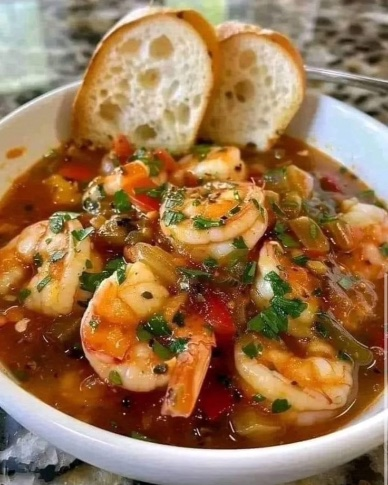Spicy Seafood Stew</a>

<a href="texas-cowboy-stew.md">Texas Cowboy Stew</a>

<a href="thai-red-curry-chicken-noodle-soup.md">Thai Red Curry Chicken Noodle Soup</a>

<a href="thai-red-curry-dumpling-soup.md">Thai Red Curry Dumpling Soup</a>

<a href="tom-kha-gai-soup.md">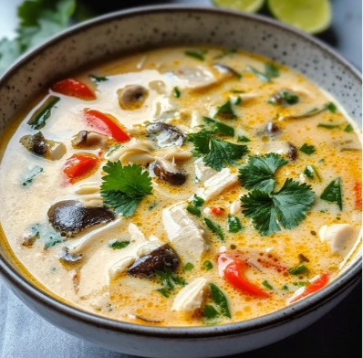Tom Kha Gai Soup</a>

<a href="tuscan-soup.md">Tuscan Soup</a>

- [Back to all recipes](../README.md)
