# Soups Recipes

43 recipes.

<a href="https://chknfrdstk.github.io/Recipes/soups/bacon-cabbage-and-potato-soup.html">Bacon Cabbage and Potato Soup</a>

<a href="https://chknfrdstk.github.io/Recipes/soups/bacon-cheeseburger-soup.html">Bacon Cheeseburger Soup</a>

<a href="https://chknfrdstk.github.io/Recipes/soups/cabbage-sausage-and-potato-soup.html">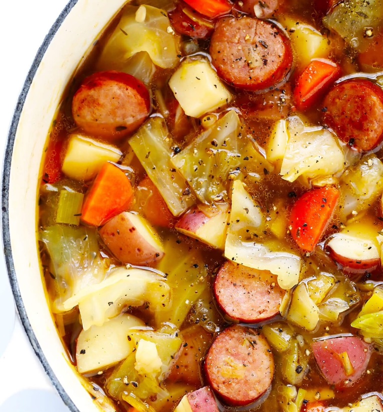Cabbage, Sausage and Potato Soup</a>

<a href="https://chknfrdstk.github.io/Recipes/soups/caldo-de-pollo.html">Caldo de Pollo</a>

<a href="https://chknfrdstk.github.io/Recipes/soups/chicken-avocado-lime-soup.html">Chicken Avocado Lime Soup</a>

<a href="https://chknfrdstk.github.io/Recipes/soups/chicken-avocado-soup.html">Chicken Avocado Soup</a>

<a href="https://chknfrdstk.github.io/Recipes/soups/chicken-fajita-soup.html">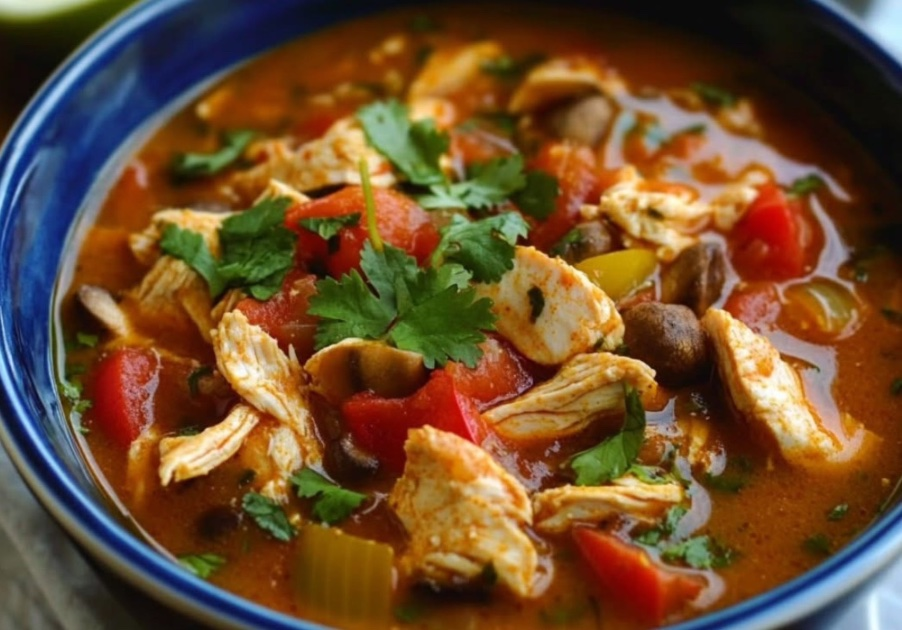Chicken Fajita Soup</a>

<a href="https://chknfrdstk.github.io/Recipes/soups/chicken-noodle-soup.html">Chicken Noodle Soup</a>

<a href="https://chknfrdstk.github.io/Recipes/soups/chinese-style-hot-and-sour-soup.html">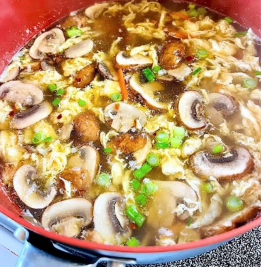Chinese Style Hot and Sour soup</a>

<a href="https://chknfrdstk.github.io/Recipes/soups/coconut-lime-seafood-chowder.html">Coconut Lime Seafood Chowder</a>

<a href="https://chknfrdstk.github.io/Recipes/soups/coconut-lime-shrimp-soup.html">Coconut Lime Shrimp Soup</a>

<a href="https://chknfrdstk.github.io/Recipes/soups/creamy-beef-taco-soup.html">Creamy Beef Taco Soup</a>

<a href="https://chknfrdstk.github.io/Recipes/soups/creamy-chicken-enchilada-soup.html">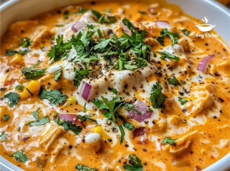Creamy Chicken Enchilada Soup</a>

<a href="https://chknfrdstk.github.io/Recipes/soups/creamy-chicken-poblano-pepper-soup.html">Creamy Chicken Poblano Pepper Soup</a>

<a href="https://chknfrdstk.github.io/Recipes/soups/creamy-crab-and-shrimp-seafood-bisque.html">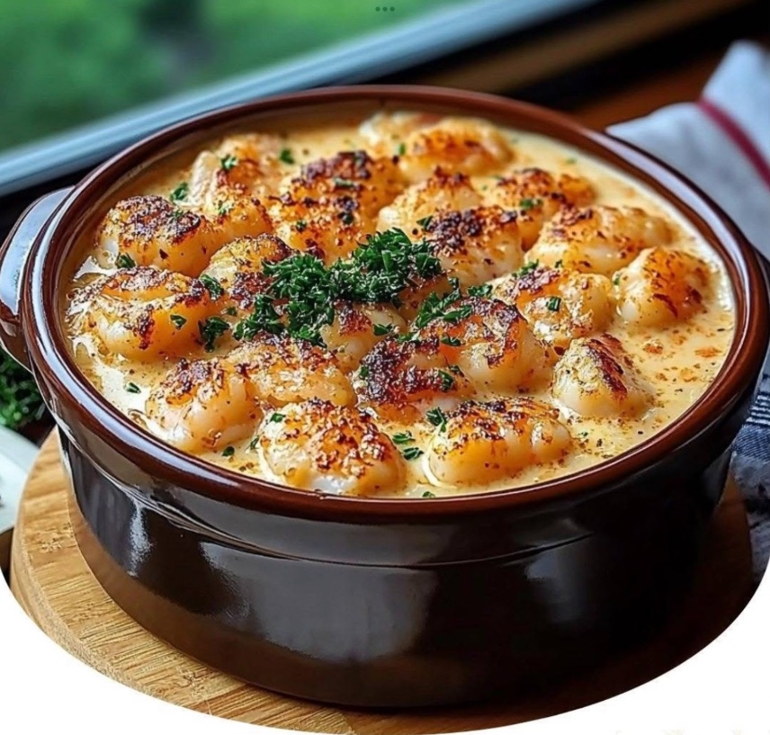Creamy Crab and Shrimp Seafood Bisque</a>

<a href="https://chknfrdstk.github.io/Recipes/soups/creamy-crockpot-chicken-chili.html">Creamy Crockpot Chicken Chili</a>

<a href="https://chknfrdstk.github.io/Recipes/soups/creamy-mushroom-chicken-and-wild-rice-soup.html">Creamy Mushroom Chicken and Wild Rice Soup</a>

<a href="https://chknfrdstk.github.io/Recipes/soups/creamy-parmesan-italian-sausage-ditalini-soup.html">Creamy Parmesan Italian Sausage Ditalini Soup</a>

<a href="https://chknfrdstk.github.io/Recipes/soups/creamy-parmesan-italian-sausage-soup.html">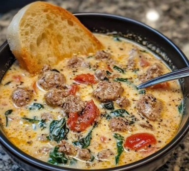Creamy Parmesan Italian Sausage Soup</a>

<a href="https://chknfrdstk.github.io/Recipes/soups/creamy-parmesan-mushroom-and-spinach-tortellini-soup.html">Creamy Parmesan Mushroom and Spinach Tortellini Soup</a>

<a href="https://chknfrdstk.github.io/Recipes/soups/creamy-spicy-jalapeno-shrimp-soup.html">Creamy Spicy Jalapeño Shrimp Soup</a>

<a href="https://chknfrdstk.github.io/Recipes/soups/creamy-spicy-jalapeno-shrimp-soup-2.html">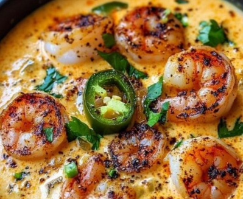Creamy Spicy Jalapeño Shrimp Soup</a>

<a href="https://chknfrdstk.github.io/Recipes/soups/crock-pot-creamy-chicken-parmesan-soup.html">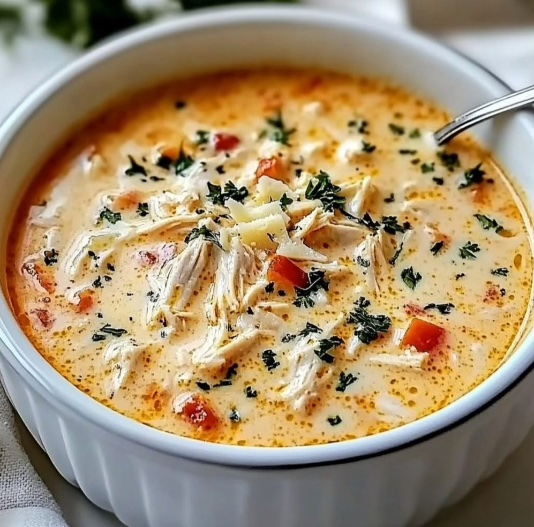Crock Pot Creamy Chicken Parmesan Soup</a>

<a href="https://chknfrdstk.github.io/Recipes/soups/crock-pot-green-enchilada-chicken-soup.html">Crock Pot Green Enchilada Chicken Soup</a>

<a href="https://chknfrdstk.github.io/Recipes/soups/hungarian-mushroom-soup.html">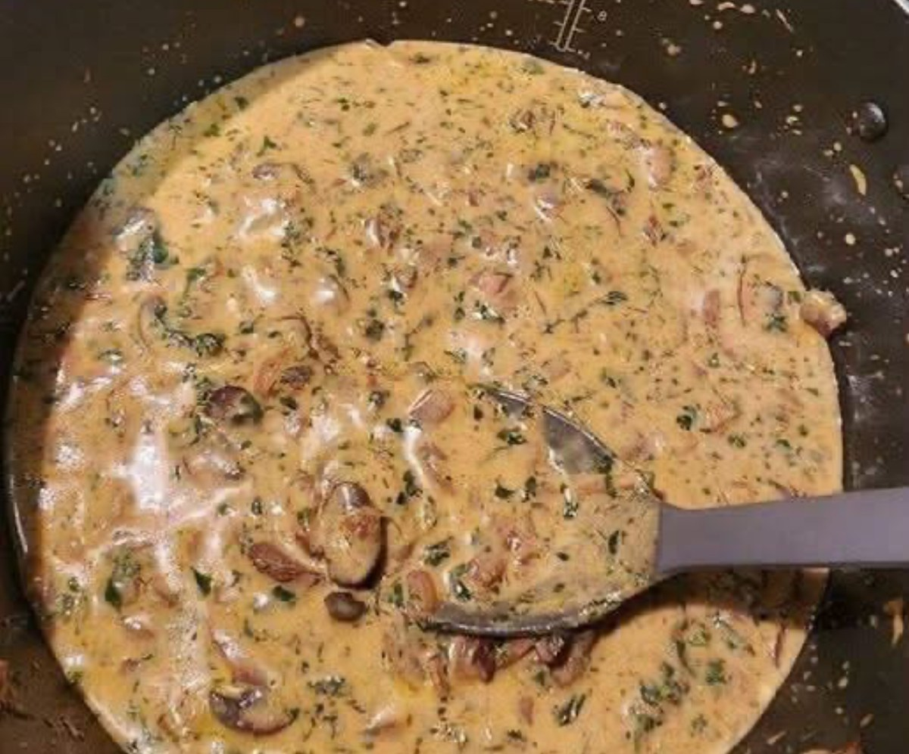Hungarian Mushroom Soup</a>

<a href="https://chknfrdstk.github.io/Recipes/soups/keto-unstuffed-cabbage-soup.html">Keto Unstuffed Cabbage Soup</a>

<a href="https://chknfrdstk.github.io/Recipes/soups/lemon-chicken-orzo-soup.html">Lemon Chicken Orzo Soup</a>

<a href="https://chknfrdstk.github.io/Recipes/soups/mexican-corn-chicken-soup.html">Mexican Corn Chicken Soup</a>

<a href="https://chknfrdstk.github.io/Recipes/soups/mexican-sopa-de-fideo-with-potatoes-beans-and-ground-beef.html">Mexican Sopa de Fideo with Potatoes, Beans, and Ground Beef</a>

<a href="https://chknfrdstk.github.io/Recipes/soups/mexican-street-corn-chicken-soup.html">Mexican Street Corn Chicken Soup</a>

<a href="https://chknfrdstk.github.io/Recipes/soups/one-pot-macaroni-cheeseburger-soup.html">One Pot Macaroni Cheeseburger Soup</a>

<a href="https://chknfrdstk.github.io/Recipes/soups/potsticker-soup-with-mushrooms-bok-choy.html">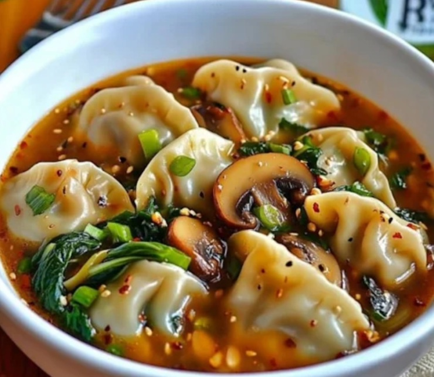Potsticker Soup with Mushrooms & Bok Choy</a>

<a href="https://chknfrdstk.github.io/Recipes/soups/ranch-taco-soup.html">Ranch Taco Soup</a>

<a href="https://chknfrdstk.github.io/Recipes/soups/rotisserie-chicken-mushroom-soup.html">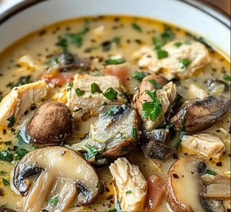Rotisserie Chicken Mushroom Soup</a>

<a href="https://chknfrdstk.github.io/Recipes/soups/sausage-tortellini-soup.html">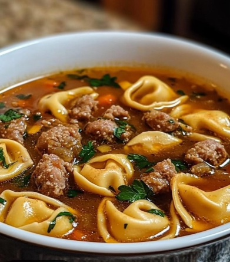Sausage Tortellini Soup</a>

<a href="https://chknfrdstk.github.io/Recipes/soups/spicy-jalapeno-popper-chicken-soup.html">Spicy Jalapeño Popper Chicken Soup</a>

<a href="https://chknfrdstk.github.io/Recipes/soups/spicy-lemon-fish-soup.html">Spicy Lemon Fish Soup</a>

<a href="https://chknfrdstk.github.io/Recipes/soups/spicy-seafood-stew.html">Spicy Seafood Stew</a>

<a href="https://chknfrdstk.github.io/Recipes/soups/texas-cowboy-stew.html">Texas Cowboy Stew</a>

<a href="https://chknfrdstk.github.io/Recipes/soups/thai-red-curry-chicken-noodle-soup.html">Thai Red Curry Chicken Noodle Soup</a>

<a href="https://chknfrdstk.github.io/Recipes/soups/thai-red-curry-dumpling-soup.html">Thai Red Curry Dumpling Soup</a>

<a href="https://chknfrdstk.github.io/Recipes/soups/tom-kha-gai-soup.html">Tom Kha Gai Soup</a>

<a href="https://chknfrdstk.github.io/Recipes/soups/tuscan-soup.html">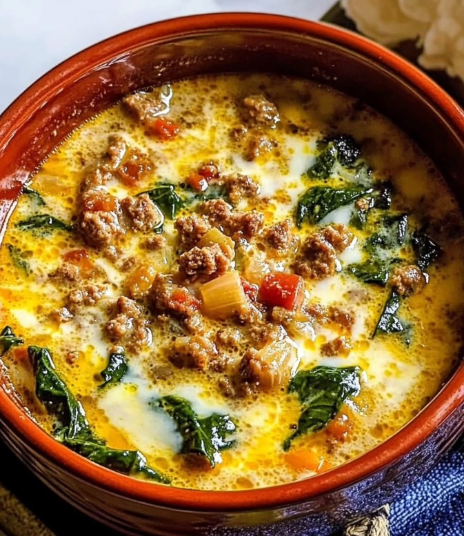Tuscan Soup</a>

- [Back to all recipes](https://chknfrdstk.github.io/Recipes/)
