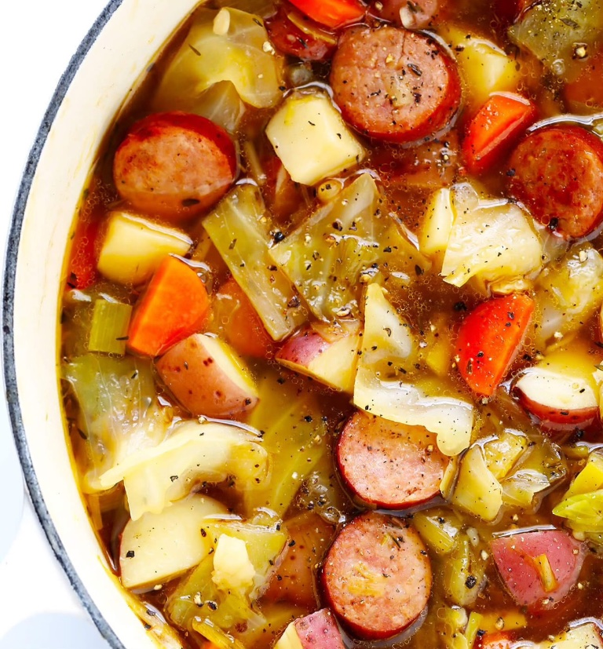

# Cabbage, Sausage and Potato Soup

## Ingredients

- 1 pound kielbasa sausage sliced into bite-sized pieces
- 2 tbsp olive oil
- 3 medium leeks sliced into ⅛ inch rounds white and pale green parts only
- 2 medium carrots peeled and diced
- 1 stalk celery diced
- 1 small green cabbage chopped into bite-sized pieces
- 3 cloves garlic minced
- 6 cups chicken or vegetable stock
- 1 pound red potatoes diced
- 1 tbsp Italian seasoning
- 1 bay leaf
- Salt and pepper to taste

## Instructions

1. Add sausage to a large stockpot and cook over medium-heat for 5-6 minutes, stirring and flipping occasionally, until the sausage is lightly browned. Use a slotted spoon to transfer the sausage to a separate plate, and set aside.
2. Add the olive oil, leeks, carrots and celery to the pan, and stir to combine. Sauté for 5 minutes, stirring occasionally. Then add the cabbage and garlic, and sauté for 4 more minutes, stirring occasionally.
3. Add the stock, potatoes, Italian seasoning, bay leaf, cooked sausage, and stir to combine. Continue cooking until the soup reaches a simmer. Then reduce heat to medium-low, cover, and simmer for 15 minutes, or until the potatoes are cooked and tender.
4. Remove and discard the bay leaf. Taste and season with a few generous pinches of salt and black pepper as needed. (Also, depending on how seasoned your sausage is, feel free to stir in a extra few teaspoons of Italian seasoning if you think it needs some extra flavor. A pinch of crushed red pepper flakes will also help bring out the flavors.)
