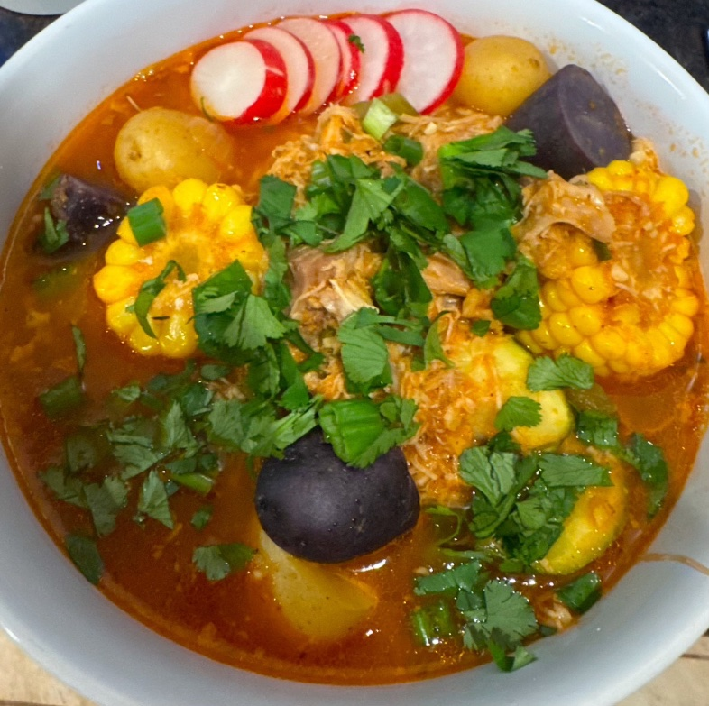

# Caldo de Pollo

## Ingredients

- 8 Chicken thighs, skin on and bone in
- 8-10 cups chicken broth
- 1 onion, diced
- 8 cloves garlic, minced
- 4-6 celery stalks, sliced, depending on size
- salt and pepper to taste, be careful with the salt
- 2 tsp cumin
- 2 bay leaves
- 1/2 cup cilantro, reserve some for garnish
- 1/2 cup green onion, sliced, reserve some for garnish
- 2 tsp oregano
- 2 cans tomato sauce
- 5-6 carrots peeled and sliced, depending on size
- 1 lb potatoes, diced
- 6 3 in corn on the cob, halved
- 4-5 mexican zucchini, halved and sliced, depending on the size
- lime wedges for serving
- 1 avocado, sliced, for serving
- 4 dried chili de arbol
- 1 dried chili de guajillo

## Instructions

1. Add chicken to stock pot or dutch oven
2. Add chick stock, bay leaves, garlic, onion, celery, chilis and cumin to the pot,
3. Bring to a boil, then reduce heat to medium and simmer for 2 hours. As the caldo simmers, foam will rise to the top. Skim off the foam so the broth remains clear.
4. Remove the chilis from the pot and remove the seeds and stems.
5. Add chilis, cilantro, and tomato sauce to a blender. Blend until the chilis are well incorporated, then add back to the caldo.
6. Add green onion, oregano and carrots to the pot. Cook for 15-20 minutes.
7. Add diced potatoes and corn cobs. Cook for 15 minutes.
8. Add zucchini and cook until the potatoes are cooked through.
9. Remove the bay leaves and disgard.
10. Remove the chicken and dice or shred, removing the bones and most of the skin.
11. Add the chicken back to the pot and served topped with cilantro, green onions and sliced avocado.
