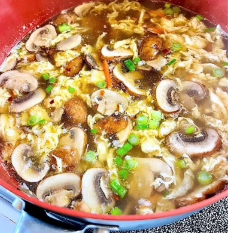

# Chinese Style Hot and Sour soup

## Ingredients

- 2 eggs beaten in a small bowl
- 1/2 cup sliced tofu- you can add more if you want
- 1 cup sliced mushrooms
- 1/4 cup green onions sliced
- 1 tbsp chili flakes
- 1 tbsp ginger slices or 1 tsp ground ginger
- 1/4 cup sliced carrots (optional)
- 4 cups chicken broth
- 2 tbsp rice vinegar
- 1 tsp black pepper
- 1/2 tsp sugar
- 3 tbsp soy sauce
- 1/2 tsp sesame oil
- Salt and pepper to taste
- 1 tbsp cornstarch for slurry
- 3 tbsp water for slurry

## Instructions

1. In a big pot, add and boiled the soup base. Once it boils, add mushrooms, sliced tofu, ginger, chili flakes, and sliced carrots.
2. Reduce and simmer for 2 minutes.
3. Pour the beaten eggs slowly while stirring to make ribbons.
4. Add the corn starch slurry. Simmer for 1-2 minutes.
5. Add green onions.
6. Add salt and pepper to taste.
