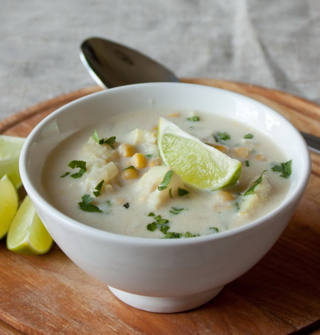

# Coconut Lime Seafood Chowder

## Ingredients

- 2 lb white fish fillets cod, tilapia or haddock)
- 1 lb scallops
- 1 lb shrimp
- 2 cans coconut milk
- 8 cups seafood broth (vegetable broth can be subbed if seafood broth is not available
- 2 tbsp coconut oil
- 2 medium onions finely chopped
- 4 cloves garlic minced
- 2 tbsp fresh ginger
- 2 red bell peppers diced
- 2 medium carrots diced
- 3-4 small potatoes peeled and diced
- 3-4 tbsp fish sauce
- Zest and juice of 1 lime
- 1 tsp red pepper flakes
- Salt and pepper to taste
- Fresh cilantro for garnish
- Chopped green onion for garnish
- Lime wedges for serving

## Instructions

1. In a large pot, heat the coconut oil over medium heat.
2. Add the chopped onion and sauté until translucent.
3. Add the garlic and ginger, sautéing until fragrant.
4. Add the bell peppers, carrots and potatoes. Sauté 3-4 minutes to soften slightly.
5. Pour in the broth and coconut milk, stirring to combine. Bring to a gentle simmer. Let the soup simmer until the potatoes are tender.
6. Gently add the diced fish, scallops and shrimp to the pot, stirring gently. Let the soup simmer until the seafood is cooked through.
7. Add the lime zest, lime juice, fish sauce and red pepper flakes. Season with salt and pepper to taste.
8. Ladle the chowder in to bowls, garnishing with cilantro and chopped green onions. Serve with Lime wedges on the side.

*Photo: Vkusny Blog — [Cod Chowder in Coconut Milk](https://www.vkusnyblog.com/recipe/chauder-iz-treski-na-kokosovom-moloke/)*
