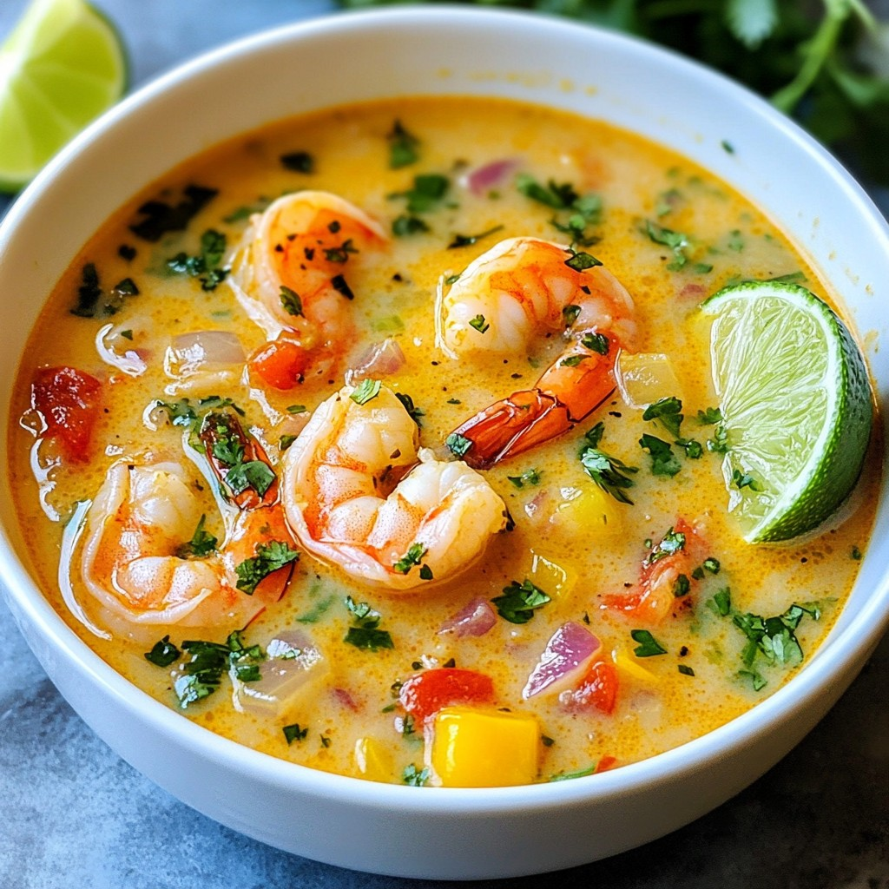

# Coconut Lime Shrimp Soup

## Ingredients

- 14 oz large shrimp peeled and deveined
- 1 can coconut milk
- 4 cups chicken or vegetable broth
- 1 tbsp olive oil
- 1 medium onion finely chopped
- 2 garlic cloves minced
- 1 tbsp fresh ginger grated
- 1 red bell pepper sliced
- 1 cup snap peas or green beans
- 2 tbsp fish sauce (or soy sauce for a vegetarian option)
- Juice and zest of 2 limes
- 1 tsp red pepper flakes (adjust to taste)
- Fresh cilantro or parsley chopped for garnish
- Salt and pepper to taste

## Instructions

1. Heat olive oil In a large pot, heat the olive oil over medium heat.
2. Add the chopped onion and sauté for about 3-4 minutes, until it becomes translucent.
3. Stir in the minced garlic and grated ginger. Cook for an additional 1-2 minutes until fragrant.
4. Add the sliced red bell pepper and snap peas to the pot. Sauté for another 3-4 minutes until slightly tender.
5. Pour in the chicken or vegetable broth and the coconut milk. Stir well to combine and bring to a gentle simmer.
6. Once the soup is simmering, add the shrimp to the pot. Cook for about 5-7 minutes, or until the shrimp turn pink and opaque.
7. Stir in the fish sauce, lime juice, lime zest, red pepper flakes, salt, and pepper to taste. Adjust the seasoning as needed.
8. Ladle the soup into bowls and garnish with fresh cilantro or parsley. Serve warm.

*Photo: Home Cooking Style — [Coconut Lime Shrimp Soup: Flavorful and Easy Recipe](https://homecookingstyle.com/coconut-lime-shrimp-soup-flavorful-and-easy-recipe/)*

## Tips

- Add more veggies: Feel free to include additional vegetables such as carrots, mushrooms, or spinach for extra flavor and nutrition.
- For a spicier soup, add fresh sliced chili peppers or increase the red pepper flakes.
