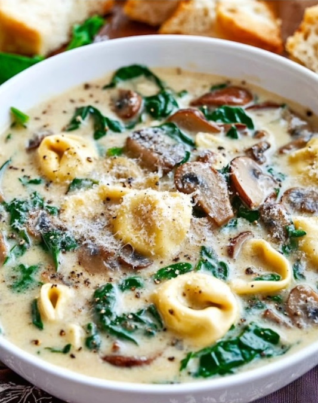

# Creamy Parmesan Mushroom and Spinach Tortellini Soup

## Ingredients

- 1 tbsp olive oil
- 1 tbsp unsalted butter
- 1 small onion, diced
- 3 garlic cloves, minced
- 8 oz cremini or button mushrooms, sliced
- 4 cups chicken or vegetable broth
- 1 cup heavy cream
- 1 tsp dried thyme
- 1/2 tsp red pepper flakes (optional, for heat)
- 9 oz cheese tortellini (fresh or frozen)
- 2 cups fresh spinach, roughly chopped
- 1 cup grated Parmesan cheese (plus extra for garnish)
- Salt and black pepper, to taste
- Fresh parsley, chopped (optional, for garnish)

## Instructions

1. Heat the olive oil and butter in a large pot over medium heat.
2. Add the onion and cook for 3-4 minutes, until softened.
3. Stir in the garlic and cook for an additional minute until fragrant.
4. Add the mushrooms and sauté for 5-7 minutes, until they release their moisture and begin to brown.
5. Pour in the chicken or vegetable broth and bring to a boil.
6. Stir in the heavy cream and Parmesan cheese, mixing until the cheese is fully melted and the broth is creamy.
7. Add the spinach and let it wilt, about 2-3 minutes.
8. Taste the soup and adjust seasoning with salt and black pepper as needed.
9. Ladle into bowls and garnish with extra Parmesan cheese and fresh parsley, if desired.
