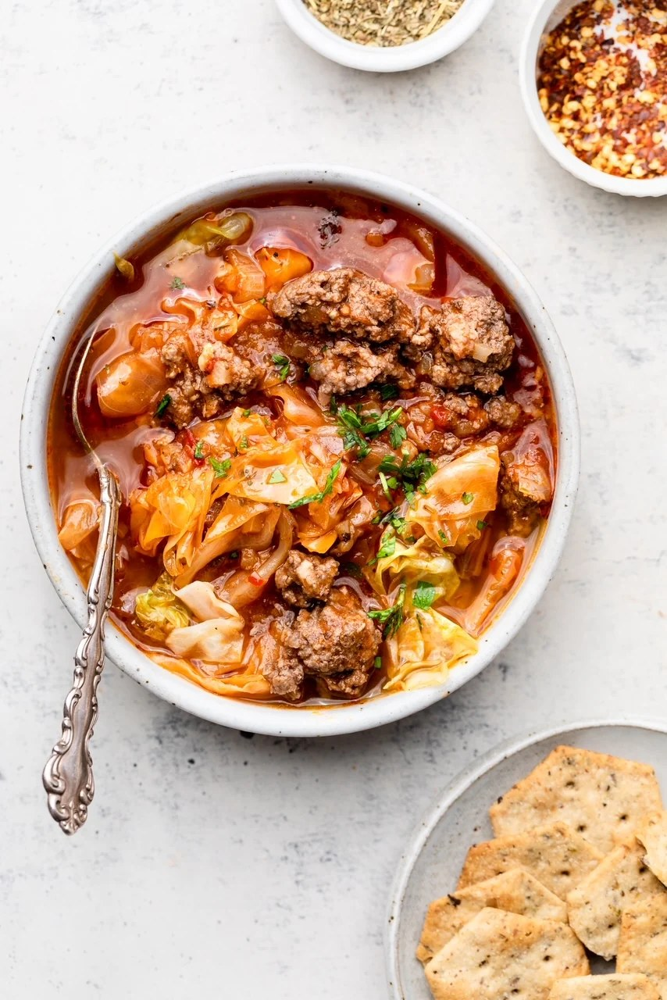

# Keto Unstuffed Cabbage Soup

## Ingredients

- 2 cups white rice
- 2 tbsp olive oil
- 1 small onion
- 3-4 cloves garlic
- 2 lbs ground beef
- 1 tsp salt dash pepper
- 2 cans diced tomatoes (14.5 ounces each)
- 1 can tomato paste (6 ounces)
- 3 tbsp Worcestershire sauce
- 32 ounces chicken broth
- 1 head cabbage sliced into strips
- extra chicken broth optional

## Instructions

1. Prepare the rice and set aside
2. In large stock pot, heat oil and saute onions and garlic unit tender and fragrant.
3. Add ground beef to stock pot and season with salt and pepper. Cook until browned.
4. Stir in tomatoes, tomato paste, Worcestershire sauce, and chicken broth. Bring to a simmer.
5. Add the cabbage and stir in.
6. Cover and cook on medium low for about 30 minutes or until cabbage has softened.
7. Stir in prepared rice. Add additional chicken broth, if desired. Simmer for another 5-10 minutes

*Photo: Mary's Whole Life — [Easy Instant Pot Unstuffed Cabbage Soup](https://www.maryswholelife.com/instant-pot-unstuffed-cabbage-soup/)*
