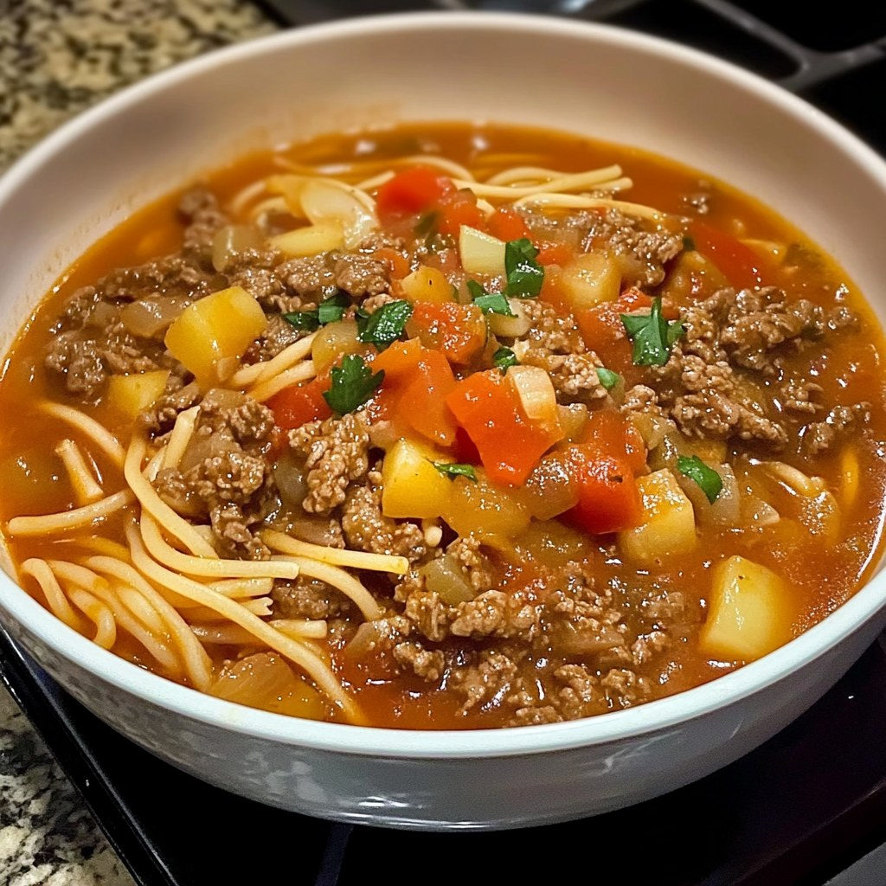

# Mexican Sopa de Fideo with Potatoes, Beans, and Ground Beef

## Ingredients

- 2 tbsp vegetable oil
- 1 lb ground beef
- 1 medium onion diced
- 2 cloves garlic minced
- 2 medium tomatoes diced (or 1 can of diced tomatoes)
- 4 cups beef or chicken broth
- 2 cups water
- 1 cup fideo noodles (or other thin pasta)
- 2 medium potatoes peeled and diced
- 1 can (15 oz) pinto beans drained and rinsed
- 1 tsp ground cumin
- 1 tsp chili powder
- Salt and pepper to taste
- Fresh cilantro chopped for garnish
- Lime wedges for serving

## Instructions

1. In a large pot, heat the vegetable oil over medium heat. Add the ground beef and cook until browned, breaking it apart with a spoon. Drain excess fat if necessary.
2. Add the diced onion to the pot and sauté until it becomes translucent, about 3-4 minutes. Stir in the minced garlic and cook for another minute until fragrant.
3. Stir in the diced tomatoes and cook for about 5 minutes until they soften.
4. Pour in the beef or chicken broth and water. Bring to a boil, then reduce the heat to low. Add the cumin, chili powder, salt, and pepper.
5. Add the diced potatoes and cook until they are tender, about 10-15 minutes.
6. Once the potatoes are cooked, add the fideo noodles and cook for an additional 5-7 minutes, or until the noodles are tender.
7. Stir in the drained pinto beans and heat through for another 2-3 minutes.
8. Ladle the sopa de fideo into bowls and garnish with fresh cilantro. Serve with lime wedges on the side for squeezing over the soup.

*Photo: Kitchen Momy — [Sopa De Fideo Con Carne](https://www.kitchenmomy.com/sopa-de-fideo-con-carne/)*
