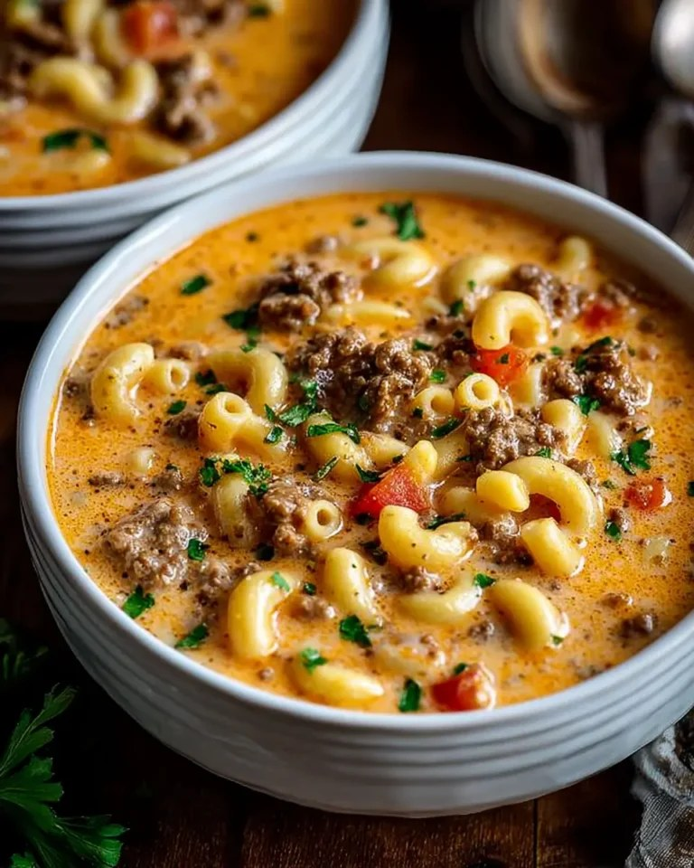

# One Pot Macaroni Cheeseburger Soup

## Ingredients

- 1 lb ground beef
- 1 medium onion diced
- 2 cups beef broth
- 2 cups elbow macaroni
- 1 cup shredded cheddar cheese
- 1 cup milk
- Salt and pepper to taste

## Instructions

1. In a large pot, brown the ground beef and onion over medium heat until cooked through. Drain the excess fat.
2. Add beef broth and bring to a boil.
3. Stir in the macaroni and cook until al dente.
4. Reduce heat and add the milk and cheese, stirring until the cheese is melted and soup is creamy.
5. Season with salt and pepper to taste and serve.

*Photo: Recipes Realm — [One Pot Macaroni Cheeseburger Soup](https://recipesrealm.com/one-pot-macaroni-cheeseburger-soup/)*
