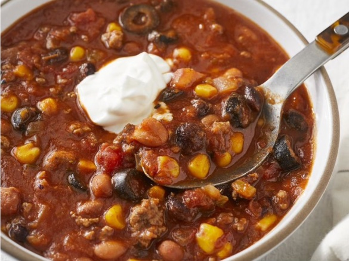

# Ranch Taco Soup

## Ingredients

- 1 lb ground beef
- 1 medium onion chopped
- 1 jalapeno pepper seeded and minced
- 2 1/2 cups water
- 2 - 15 oz cans crushed tomatoes
- 3 - 15 oz cans pinto beans drained
- 1 - 15 oz can whole kernel corn, drained
- 1 - 10 oz can diced tomatoes and green chiles
- 1 - 1 oz packet ranch dressing mix
- 1 - 1 oz packet taco seasoning mix

## Instructions

1. Combine ground beef, onion, and jalapeño in a 4-quart soup pot. Cook over medium-high heat until beef is cooked through and no longer pink.
2. Add water, crushed tomatoes, pinto beans, corn, black beans, RO*TEL, black olives, ranch dressing, and taco seasoning. Mix to combine. Bring soup to a boil, reduce heat, and simmer for 30 minutes.
