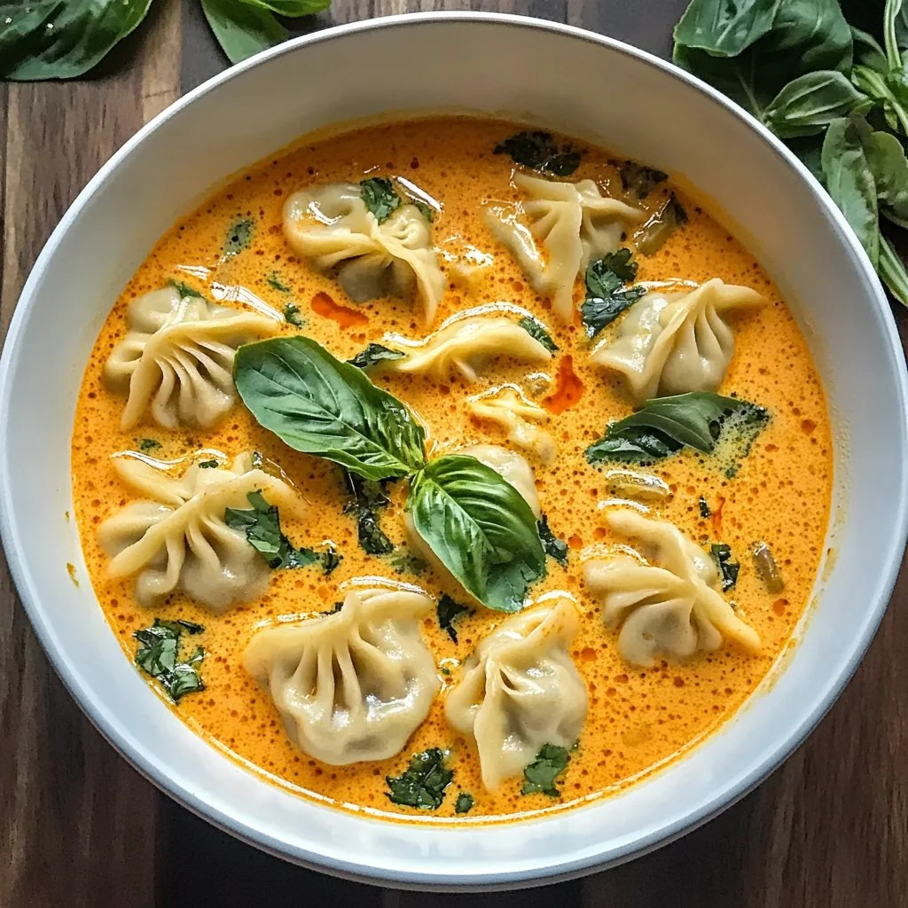

# Thai Red Curry Dumpling Soup

## Ingredients

- 1 tbsp vegetable oil
- 1 onion diced
- 3 cloves garlic minced
- 1 tbsp fresh ginger minced
- 3 tbsp red curry paste
- 4 cups chicken broth
- 1 can (14 oz) coconut milk
- 1 cup snap peas
- 1 red bell pepper sliced
- 1 cup cooked dumplings
- 2 tbsp soy sauce
- 8 oz shitake mushrooms
- 1/2 cup shredded carrots
- Fresh cilantro and lime wedges for garnish

## Instructions

1. In a large pot, heat vegetable oil over medium heat. Add the diced onion and sauté until soft.
2. Stir in the garlic and ginger, cooking until fragrant.
3. Add the red curry paste and stir for 1-2 minutes to release its flavor.
4. Pour in the chicken broth and coconut milk. Bring it to a gentle simmer.
5. Add the snap peas, red bell pepper, mushrooms and carrots, cooking until the vegetables are tender-crisp.
6. Gently stir in the frozen dumplings and soy sauce. Simmer until the dumplings are cooked through.
7. Serve hot, garnished with fresh cilantro and lime wedge.

*Photo: Sophia Yummy — [Soup Dumplings in Thai Red Curry Sauce](https://sophiayummy.com/soup-dumplings-in-thai-red-curry-sauce/)*
